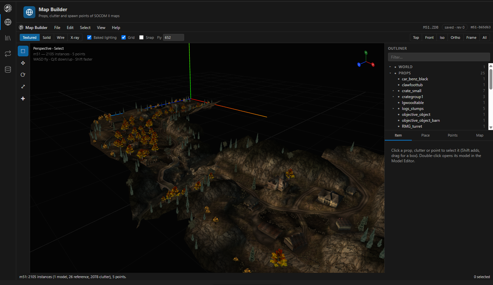
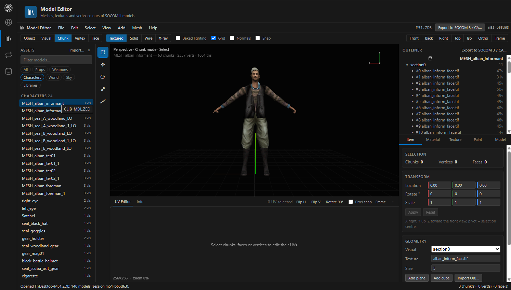
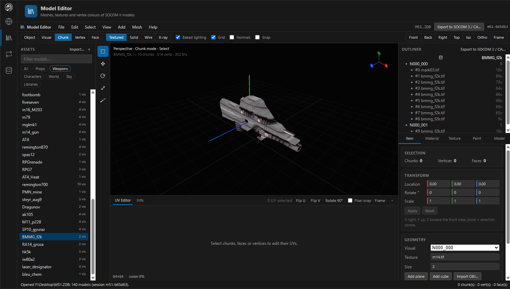
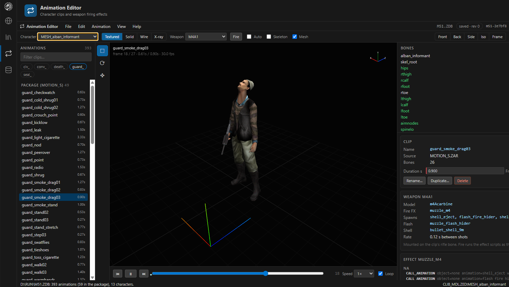
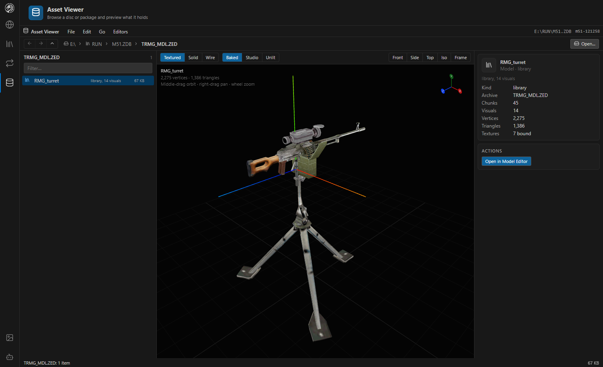
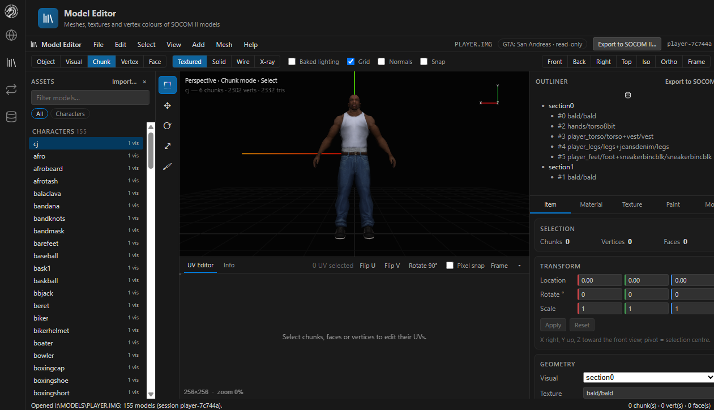
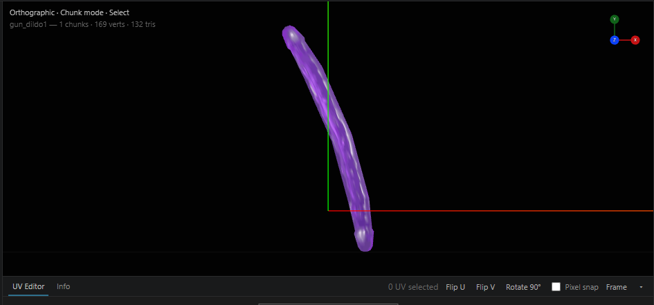
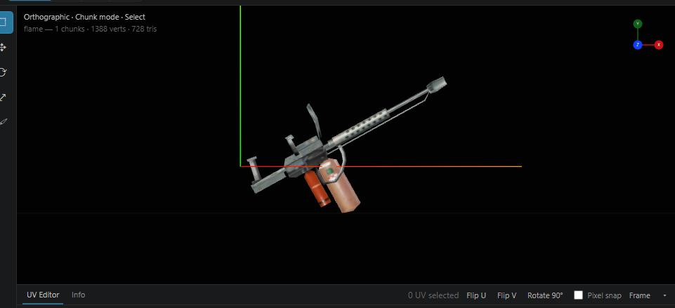

<p align="center">
  
</p>

<h1 align="center">SOCOM Map Builder</h1>

<p align="center">
  A work-in-progress toolkit for exploring and editing PlayStation 2 game assets.
</p>

<p align="center">
  Build maps and edit models, textures, palettes, and character animations in SOCOM U.S. Navy SEALs II packages, with additional support for SOCOM 3, Combined Assault, and experimental GTA: San Andreas model workflows.
</p>

<p align="center">
  <strong>Status:</strong> SOCOM II is the primary tested target. SOCOM 3 and Combined Assault support varies by workflow; GTA: San Andreas support is partial, and FTB has not been tested.
</p>

<p align="center">
  Developed with research and assistance from CodeDesigner AI. Runtime injection and map-launching source code from CodeDesigner is not included in this repository yet.
</p>

---

Open a game package and work across the map, its props and clutter, vehicles, characters, weapons, textures, palettes, and character animations. The editors share one in-memory package session, so changes made across different pages can be saved together as a copy of the `.ZDB` / `.CDB` package or exported as a memory-card pack for `mc0:`.

**Keep your originals safe:** edits stay in the session until you save or export. Work on copies, and test modified packages in-game before relying on them.

## Contents

- [Pages and editors](#pages)
- [Examples](#examples)
- [Getting started](#getting-started)
- [Working with packages](#working-with-packages)
- [Controls](#controls)
- [Architecture](#how-it-fits-together)
- [Command reference](#command-reference)
- [Format notes](#format-notes)
- [Format documentation](docs/formats/README.md)
- [Roadmap and work tracker](docs/ROADMAP.md)
- [Development](#development)
- [Status and limits](#status-and-limits)

## Pages

Use the activity bar to switch between tools. Editors load on their first visit, then remain mounted so their sessions, cameras and selections survive switching. The editors are connected: double-click a prop on the map to open it in the Model Editor, or double-click a model in the Asset Viewer to open it there.

### Map Builder



Inspect the assembled level with its world model, props, clutter, sky, textures, and baked lighting. Select and transform instances directly in the scene.

- Move, rotate, scale, duplicate and delete props and clutter; drop them to the ground.
- Place clutter on any surface with the Place tool. Preview the model before clicking, choose yaw and scale (or random yaw and a random scale range), and optionally align it to the surface. Escape cancels placement. The Clutter layer must be visible and unlocked.
- Set render resolution to 100%, 75%, or 50%, choose smooth or pixel texture filtering, and enable FPS, draw-call, triangle, and resource statistics. These rendering preferences are remembered in your browser. Render pixel density is capped at 2×; 50% resolution uses one quarter of the pixels of 100%.
- Move the AIMAPS spawn and waypoint points.
- Edit a multi-selection at once (move by, turn by, set scale); lock layers so clicks and box drags skip them; move a single prop along its own axes (Local).
- **Import from package…** (File menu or the Place tab): bring a prop, vehicle, weapon or character from another package, then place it.
- Facade trees face the camera, as they do in game.
- View style, grid, projection, snapping and placement preferences are remembered in your browser.
- Open **Help → Keyboard shortcuts…** (or press `?`) to search the controls.
- Loading warnings stay visible with a **Retry map loading** action. A failed package switch clears the old map, and scene-loading failures block editing until a reload succeeds.

### Model Editor





Edit props, vehicles, weapons, and skinned characters using object-level and geometry-level tools.

- Select by object, visual, chunk, vertex or face; move / rotate / scale; mirror, flip normals, snap to grid.
- Add planes, cubes or an OBJ; duplicate and delete faces; edit UVs.
- Paint baked vertex colours.
- **Textures**: retexture sections, replace a texture from any image (PNG, JPG, BMP, WebP), create a **new texture from an image** (with its own palette, or reusing one), **import a texture from another package**, create a **palette from an image**, export PNG.
- **Import from package…** (Assets panel or File menu): copy a model from another package.
- Export OBJ; convert models to SOCOM 3 / Combined Assault, and CA or GTA: San Andreas models to SOCOM II.

### Animation Editor



Preview character clips on skinned models. Package-local `MOTION_S.ZAR` clips are editable; the shared `MOTION_P.ZAR` is read-only.

- Create, duplicate, rename, delete and retime clips; key bones with the gizmo or exact fields.
- With the game's RUN folder available, weapons mount on the clip and fire their muzzle effects.

### Asset Viewer



Browse a whole disc (or any folder) down into packages and archives, preview what is there, and send it to the editor that works on it. The page has the editors' layout: the browser on the left, the preview in the middle, what the selection is and what can be done with it on the right.

- Open a folder (File › Open folder…, Ctrl+O) — the SOCOM II disc's drive, its RUN folder, or a folder of packages — and browse folders, .ZDB / .CDB packages and the .ZAR / .ZED archives inside them, with breadcrumbs, Back / Forward / Up, a filter and kind chips. Lists of thousands of records (RUN/SOUNDS/VAGSTORE.ZAR holds 10 942) scroll without slowing down.
- Package archives list what the editors list, from the same asset session: models, textures, palettes, GEO definitions and animation clips (a loose RUN/MOTION_P.ZAR borrows a session from a package beside it).
- Previews use the editors' own code: models in the Model Editor's viewport, a package's composed map in the Map Builder's (Show map), clips playing on a character in the Animation Editor's, textures through ASSET_TEXTURE.
- Every file type on the retail disc previews: memory-card icons (.ICO, in 3D with their texture) and icon lists, sounds (.VAG and the VAGSTORE / BNKSTORE stores, .BNK / .BD banks sample by sample) played in the page, the RAW / RGB loading screens, RDR trees, AI maps, text (.CNF), programs (.ELF, .IRX: sections, IOP module name), movies (.PSS: picture size, frame rate, length, and **Convert for preview**, which takes out its sound track (the PS2's "SShd" PCM stream, which ffmpeg does not read) and has ffmpeg join it to the picture as an H.264 / AAC MP4, kept in `%LOCALAPPDATA%\MapBuilder\movies`, so it plays in the page; needs ffmpeg on the server: `winget install Gyan.FFmpeg` or `MAPBUILDER_FFMPEG`), and a hex dump with strings for anything else.
- Actions: open in the Map Builder, Model Editor or Animation Editor; export a texture, screen or icon texture as PNG and a sound as WAV; extract any record as stored.
- **Import… / Replace… / Remove**: change a package's files or an archive's records; the result is written to a file you choose.
- **Edit in place** (Edit menu: Undo Ctrl+Z, Redo Ctrl+Y, Save changes… Ctrl+S): RDR values, strings and list items (duplicate / remove), AI map headers and points, text files, icon.sys titles, a byte patcher for any record, and pictures (textures, RAW / RGB screens, icon textures) replaced from an image. Edits go through the package's asset session (a .ZDB's, or a loose file's folder's) and are spliced into their archives in place, so every other byte stays as it was.

Edits in the editors are undoable. SOCOM 3 / Combined Assault archives and GTA: San Andreas (.ISO or .IMG) open read-only.

## Examples


*Example: a custom weapon asset.*


*Example: a vehicle model.*


*Example: a tank model.*


*Example: a character asset from Combined Assault.*

### GTA: San Andreas compatibility (partial)

Character and prop workflows are working, along with some vehicles. This support is still incomplete, so treat exports as experimental and verify the results in your target workflow.



*GTA: San Andreas example: character model support.*



*GTA: San Andreas example: prop model support.*



*GTA: San Andreas example: weapon model export workflow.*

## Getting started

### Requirements

- [.NET 8 SDK](https://dotnet.microsoft.com/download/dotnet/8.0)
- [Node.js](https://nodejs.org/) 20 or later
- Your own SOCOM II packages (this repository does not include game files)
- A supported SOCOM II package to edit, such as a `.ZDB` / `.CDB` package or an unpacked package folder

### Build and run

```bash
cd web
npm ci
npm run build
```

```bash
cd server
dotnet run
```

Open [http://127.0.0.1:8770](http://127.0.0.1:8770) and choose **File → Open package…** (`Ctrl+O`). The file browser lists your drives and folders. Select a map package such as `RUN\MP\M51\M51.ZDB`, a `.CDB` pack, a loose `.ZED`, or an unpacked package folder.

In Visual Studio, open `MapBuilder.sln` and press F5 (after `npm run build` in `web/`); the launch profile uses the same address.

The server binds to `127.0.0.1:8770`, so only your own browser can reach it. Pass `--urls http://127.0.0.1:9000` for another port. If the page has not been built, the server still starts and says so in its console.

The API can read and write any file your account can, so the server also only answers requests addressed to `localhost`, `127.0.0.1` or `[::1]`; this stops a web page from reaching it by pointing its own domain at your machine (DNS rebinding). To serve it under another name, pass both, e.g. `--urls http://0.0.0.0:8770 --AllowedHosts "mypc;localhost"`; the console then warns that the API is reachable from the network.

## Working with packages

- **Changes are session-based until you save or export.** **Save copy** (`Ctrl+S`) writes a new `.ZDB` or `.CDB`; **Export memory-card pack** writes `<NAME>.CDB` for `mc0:/BASCUS-97275<NAME>/`. Pack names start with `m` and can contain up to 7 letters or digits.
- **Asset Viewer edits** (Import / Replace / Remove) ask where to save. Saving over the open file keeps a `<name>.bak` the first time.
- **Saves are written whole or not at all**: the new file goes to `<name>.tmp` and then replaces the target, so a crash mid-save leaves the old file. Writing over an existing file keeps `<name>.bak` once (the original); delete it yourself when you no longer need it.
- **Work on copies.** Keep your original packages untouched and test modified packages in-game before using them.
- **Importing a model** copies its MDL record, its GEO definition (a character's skeleton), every texture its sections name with their mip levels, their palettes, and any models its definition is built from. Undo removes the whole import.
- **New textures** are 8-bit indexed, a power of two a side (8–512, default: the image rounded, at most 256), with a 256-colour palette made from the image (32-bit when the image has soft alpha, else 16-bit like most retail palettes).

## Controls

| Action | Keys |
|---|---|
| Fly | W A S D, Q / E down / up, Shift faster (viewport focused) |
| Orbit / pan / zoom | Middle drag or Alt + left drag / right drag / wheel |
| Keyboard orbit | Arrow keys while held (Left / Right turn, Up / Down tilt, Shift faster) · Numpad 4 / 6 / 8 / 2 in 15° steps · Numpad 9 opposite side · Numpad + / − zoom (every 3D view) |
| Tools | V select · G move · R rotate · T scale · P place |
| Duplicate / delete / drop | Shift+D / X or Delete / End |
| Copy / paste clutter | Ctrl+C / Ctrl+V (also into another package that has the model) |
| Frame selected / frame map | F / Home |
| Views | Numpad 1 front · 3 right · 7 top · 5 orthographic; with Ctrl: back · left · bottom |
| Shading | Z cycles textured, solid, wire, X-ray |
| Lighting / backdrop | Baked · Studio · Unlit in the header / image icon in the activity bar |
| Undo / redo / save copy | Ctrl+Z / Ctrl+Y / Ctrl+S |
| Asset Viewer | Double-click / Enter opens · Backspace up · Alt+Left / Right back / forward · arrows move · Space plays a clip |

## How it fits together

```
web/  React 18 + TypeScript + three.js ──POST /api/command──▶ server/  ASP.NET Core (.NET 8)
                                                                 └─ CodeDesigner.Ps2.FileFormats
                                                                    (Zipper ZDB/ZED/ZAR/GEO/MDL/TXR/PAL/RDR,
                                                                     CA and GTA codecs, conversion)
```

- The backend owns the package. Every edit is an `ASSET_*` command on an in-memory session (one per package path, shared by all pages); the pages preview and send commands.
- The Asset Viewer lists and previews with `VIEWER_LIST` / `VIEWER_PREVIEW`; package archives come from an asset session, so models, textures, maps and clips are drawn with the editors' commands and viewports. Disc formats only it reads (SPU ADPCM, memory-card icons, raw screens, PSS / ELF headers) are in `CodeDesigner.Ps2.FileFormats/Ps2`.
- `web/src/webview/` mirrors CodeDesigner's webview folders: the viewports, decoders and players are shared files, and each page's logic runs on a small dependency-tracking signals shim (`web/src/shared/signals.ts`) under a React view.

```
server/
  Program.cs                      command registry, static web root, /mcp and /api/events
  Services/McpServer.cs           MCP tools (assets_*, ui_*) over the command registry
  Services/UiBridge.cs            event stream to the pages, screenshot / state requests
  Services/AssetService*.cs       ASSET_* sessions, edits, undo, save
  Services/PackageFilesService.cs PACKAGE_EDIT (package files, archive records)
  Services/FileSystemService.cs   FS_* listings for the file browser
  CodeDesigner.Ps2.FileFormats/   format codecs (Zipper/Package: edits, import, textures)
web/src/
  AppShell.tsx                    activity bar and pages
  MapPage.tsx, viewport/          Map Builder
  webview/model-editor/           Model Editor
  webview/animation-editor/       Animation Editor
  webview/asset-viewer/           Asset Viewer
  shared/                         host (dialogs, file browser, import), signals, icons
```

## View

- **Lighting** (Map Builder and Model Editor header): **Baked** (default) draws the model's baked vertex colours as the game does, and lights models that have none with the scene lights; **Studio** lights everything with an ambient fill and a key light from the camera, ignoring baked colours (useful on night maps); **Unlit** shows textures at full brightness.
- **Backdrop** (activity bar, image icon): dark or a blueprint grid, for every 3D view and the Asset Viewer's previews. Remembered in the browser.

## AI (MCP server)

The server is also a [Model Context Protocol](https://modelcontextprotocol.io) server at `http://127.0.0.1:8770/mcp` (Streamable HTTP). The repository's `.mcp.json` registers it for Claude Code; elsewhere:

```bash
claude mcp add --transport http mapbuilder http://127.0.0.1:8770/mcp
```

The AI works on the same asset sessions as the pages, so you watch it work: the **AI activity** panel (activity bar, robot icon) lists every call with the reason the AI gave, and with **Follow AI** on, edits bring their page forward: the Map Builder reloads and frames the moved prop or point, the Model Editor opens the edited model. Edits stay undoable (`Ctrl+Z` undoes the AI's too) and nothing is written until a save.

| Tools | Do |
|---|---|
| `assets_open`, `assets_sessions`, `assets_status` | Open or join a package session |
| `assets_list_models`, `assets_describe_model`, `assets_model_mesh`, `assets_list_textures`, `assets_list_palettes`, `assets_texture` (as an image), `assets_map_scene`, `assets_map_points`, `assets_list_animations`, `assets_animation`, `assets_weapons` | Read |
| `assets_effects`, `assets_weapon_fx` | Read ZANIM effects and what firing a weapon plays |
| `assets_edit` (every `ASSET_EDIT` op; `dryRun: true` previews one without changing anything), `assets_undo`, `assets_redo`, `assets_save`, `assets_close` | Change, save and close |
| `assets_save_prefab`, `assets_list_prefabs`, `assets_delete_prefab` | Save placed props and clutter as a reusable group; `assets_edit {op: placePrefab}` places one in any map (one undo step) |
| `assets_validate`, `assets_history` | Lint a map (missing models, broken transforms, duplicate points, long texture names, VRAM budget); list the undo / redo steps |
| `assets_export`, `assets_entry` | Export a model to SOCOM 3 / CA; read or write out one of the package's files (with unsaved edits) |
| `fs_places`, `fs_list` | Find packages on disk |
| `package_inspect`, `package_edit` | List and change the files of a package or archive on disk (no session) |
| `weapons_list`, `weapons_template`, `weapons_texture`, `weapons_create` | Build a new weapon from a template in a weapon archive (model edits, a texture from an image) |
| `ui_screenshot`, `ui_state`, `ui_show`, `ui_focus`, `ui_view` | See and drive the app (screenshot of the 3D view, page / selection state, open a page or model, frame an item, shading / lighting / backdrop / camera preset, orbit and zoom) |
| `mapbuilder_command` | Any backend command from the reference below |

Tool arguments are checked against each tool's schema before it runs: unknown names, wrong types, values outside an `enum` or range, and a missing `reason` are errors. `assets_map_scene` pages with `offset` / `nextOffset`, and a reply too long for the model's context comes back as valid JSON with `truncated: true`.

Claude Code finds the tools when a session starts, so start Map Builder (`dotnet run`) before opening the Claude session; a session started without it sees no `mapbuilder` tools until it is restarted. Claude Code also asks once to approve the project's `.mcp.json` server.

The pages listen on `GET /api/events` (Server-Sent Events) and answer screenshot / state requests on `POST /api/ui/reply`. `/mcp` refuses requests from other sites' pages (a foreign `Origin` or a non-JSON body).

## Command reference

All commands are `POST /api/command` with a JSON body `{ "Command": ..., ...fields }`; the reply is `{ Success, Data }` with `Data` as JSON text.

| Command | Fields | Does |
|---|---|---|
| `ASSET_OPEN` | `InputPath` | Opens (or reuses) a session for a package, folder or archive |
| `ASSET_LIST_MODELS` / `ASSET_LIST_TEXTURES` / `ASSET_LIST_PALETTES` | `AssetSession` | The package's assets |
| `ASSET_MODEL_MESH` / `ASSET_DESCRIBE_MODEL` / `ASSET_TEXTURE` | `AssetSession`, `AssetArchive`, `AssetName` | A model's mesh and description, a texture as PNG |
| `ASSET_MAP_SCENE` / `ASSET_MAP_POINTS` | `AssetSession` | Map instances and AIMAPS points |
| `ASSET_EDIT` | `AssetSession`, `AssetJson: {op, …}` | One edit (below); `batch` runs several as one undo step |
| `ASSET_UNDO` / `ASSET_REDO` / `ASSET_SAVE` | `AssetSession` (+ `AssetJson` for save) | History and saving (`zdb` or `pack`) |
| `ASSET_SAVE_PREFAB` / `ASSET_LIST_PREFABS` / `ASSET_DELETE_PREFAB` | `AssetSession`, `AssetJson: {name, geoIndices?, clutterIndices?, origin?, replace?}` / `AssetName?` | Prefab files in `%LOCALAPPDATA%\MapBuilder\prefabs` (or `MAPBUILDER_PREFABS`) |
| `ASSET_HISTORY` / `ASSET_VALIDATE` | `AssetSession` (+ `AssetJson: {vramBudget?}` for validate) | The undo / redo steps; a map lint |
| `PACKAGE_EDIT` | `InputPath`, `OutputPath`, `Data: [ops]`, `DryRun?` | Add / replace / remove package files and archive records (refused while an open session has unsaved edits on the file) |
| `FS_PLACES` / `FS_LIST` | `InputPath` | Drives, common folders and folder listings |
| `VIEWER_EDIT` | `InputPath`, `AssetJson: {inner, op: rdrSet / rdrDuplicate / rdrRemove / mpsMap / text / bytes / image / iconSys, …}` | One in-place edit through the package's asset session (undo / redo / save with `ASSET_UNDO` / `ASSET_REDO` / `ASSET_SAVE`) |
| `VIEWER_MOVIE` | `InputPath` (a .PSS) | Converts a movie to MP4 once (ffmpeg) and answers its `/api/viewer/movie/…` stream URL |
| `VIEWER_LIST` / `VIEWER_PREVIEW` / `VIEWER_EXTRACT` | `InputPath`, `AssetJson: {inner?: [entry indices], sample?, rate?}` (+ `OutputPath` for extract) | Asset Viewer: what a folder, file or archive holds; a typed preview of one file or record; a record's bytes as stored |

Edit ops include `moveClutter`, `addClutter`, `deleteClutter`, `moveInstance`, `duplicateInstance`, `placeInstance`, `deleteInstance`, `movePoint`, `setPoint`, `setVertices`, `transformVertices`, `addMesh`, `deleteFaces`, `duplicateFaces`, `retexture`, `replaceTexture`, `tintVertexColors`, the animation ops, and:

- `placeInstance` `{model, position, yaw?, scale?, matrix?, name?, templateGeoIndex?}`: a new placed reference of a package model, copied from the placed reference nearest the position (or `templateGeoIndex`) and added beside it; answers `newGeoIndex`
- `setPoint` `{name, newName?, team?, kind?: start | waypoint | other, position?}`: changes an AIMAPS point in place (points cannot be added or removed: their table sits mid-file between structures that are not decoded yet)
- `importModel` `{sourceSession | source, archive, name, targetArchive?, newName?}`
- `importTexture` `{sourceSession | source, name, sourceNamespace?, namespace?, newName?}`
- `addTexture` `{name, pngBase64 | imagePath, namespace?, width?, height?, maxSize?, paletteId?}`
- `addPalette` `{pngBase64 | imagePath, namespace?, is16?}`
- `placePrefab` `{prefab, position, yaw?}`: every item of a saved prefab around the position, turned by yaw, as one batch (all or nothing)

## Format notes

The full decoding documentation for every asset type (packages, ZED/ZAR containers, models, GEO scenes, characters, textures and palettes, clutter, AI maps, RDR tables, animations) is in **[docs/formats](docs/formats/README.md)**. In short, the things the editors rely on, checked against retail packages:

- Model space is Y up as stored; GEO and clutter matrices are column-major with the translation in 12–14.
- A model is a top-level record of `<ns>_MDL.ZED`; its definition is a node of the same name under `models` in `<ns>_GEO.ZED` (a character's skeleton is named without `MESH_`).
- A ZED's root value is its top-level record count.
- Texture names and palette ids are global in game (the first registered wins), so imports keep a palette's id only when the target does not use it, and new palettes take ids from a block of their own (1024 + 32 × hash).
- A texture's header `+0x08` is its texture index (1..N per TXR) and equals TEX0.TBP0; MIPTBP1/2 hold its mip levels' indices; TEX0.CBP binds the palette. Header `+0x0F` is `0x12` for a 16-bit palette, `0x13` for 32-bit.
- 16-bit palettes have no alpha, only the STP bit: a black entry without it is transparent.
- Retail models name textures in 16-byte fields, so a texture applied to them needs a name of at most 15 characters.
- A package's root holds .ZED, .ZAR and .MPS files; .RDR screens live inside ZARs (READERM.ZAR).

## Development

Run the backend and the Vite dev server side by side; the dev server proxies `/api` to the backend and reloads on save.

```bash
cd server
dotnet watch
```

```bash
cd web
npm run dev
```

Open http://localhost:5173. `npm run typecheck` checks the page without building it.

Tests use synthetic data, never game files. CI (`.github/workflows/ci.yml`) runs both on every push and pull request.

```bash
dotnet test tests/MapBuilder.Tests
```

```bash
cd web
npm test
```

Browser regression checks exercise rendering, placement, layer visibility and locks, saved preferences, shortcuts, and failed-load recovery with synthetic fixtures. With the backend and Vite dev server running, run:

```bash
cd web
npm run test:browser
```

The checks use system Chromium when available at `/usr/bin/chromium`. Otherwise install a Playwright browser with `npx playwright install chromium`, or set `CHROMIUM_PATH` to your Chromium executable. `MAP_BUILDER_URL` can select a different Vite development address; `MAP_BUILDER_MCP_URL` can select a different MCP endpoint (default `http://127.0.0.1:8770/mcp`). These checks require the Vite server because they also exercise viewport modules directly; they do not require game files or modify package files.

## Status and limits

This is an actively developed tool, and support differs by game and asset type.

- **SOCOM II is the primary tested target.** The project is still being developed; not every editing workflow has been verified in-game.
- Map, model, and animation edits can round-trip through save and reopen. Imported models, imported textures, and image-created textures render in the editors, but not every combination has been tested in-game. Test on copies.
- **Runtime VRAM is limited.** Large textures or many newly added textures may exceed what a map can use in-game.
- An imported character can appear correctly in the editors, but spawning it in a mission also requires the relevant character records.
- SOCOM 3 and Combined Assault workflows vary by format and feature. GTA: San Andreas model export is partial, and FTB has not been tested.
- This repository does not include game assets or the CodeDesigner runtime source used to inject map items and launch new maps.

*SOCOM U.S. Navy SEALs is a trademark of Sony Interactive Entertainment. This project is not affiliated with or endorsed by Sony; it ships no game files.*
