<p align="center">
  
</p>

<h1 align="center">SOCOM Map Builder</h1>

<p align="center">
  A map, model, texture and animation editor for SOCOM U.S. Navy SEALs II on the PlayStation 2.
</p>

<p align="center">
  <a href="https://github.com/FatalityDevelopment/SocomMapBuilder/actions/workflows/ci.yml"></a>
  <a href="LICENSE.txt"></a>
  
  
</p>

---

Open a SOCOM II package and work across the whole map: its world, props, clutter, characters, weapons, textures, palettes, animations, actions and mission tables. Every page shares one in-memory session per package, so edits made anywhere are undone together and saved together, as a copy of the `.ZDB` / `.CDB` or as a memory-card pack for `mc0:`. A built-in MCP server lets AI assistants read and edit the same sessions while you watch.

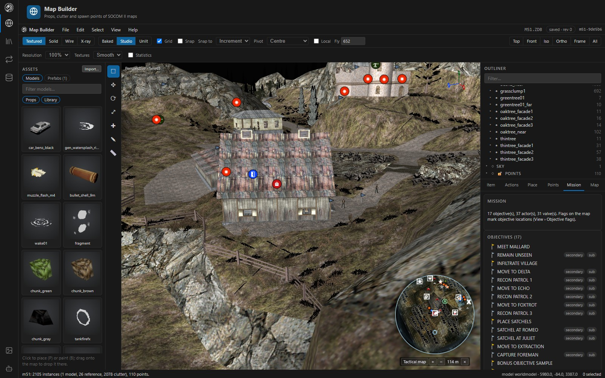

> **Get started:** build the web client, run the server and open `http://127.0.0.1:8770`. See [Getting started](#getting-started).
>
> **Status:** SOCOM II is the primary, tested target. SOCOM 3 and Combined Assault open read-only, and GTA: San Andreas model support is partial. See [Game support](docs/game-support.md).

## Contents

- [What it does](#what-it-does)
- [How it fits together](#how-it-fits-together)
- [Feature showcase](#feature-showcase)
  - [Map Builder](#map-builder)
  - [Model Editor](#model-editor)
  - [Animation Editor](#animation-editor)
  - [Asset Viewer](#asset-viewer)
  - [AI-assisted editing](#ai-assisted-editing-with-mcp)
- [In game](#in-game)
- [Getting started](#getting-started)
- [Documentation](#documentation)
- [Status and limits](#status-and-limits)
- [Related projects](#related-projects)

## What it does

| Area | Highlights |
|---|---|
| **Map Builder** | The composed map with baked lighting. Place, move, rotate and scale props and clutter; clutter brush; prefabs; snapping, align and distribute; spawn and waypoint points; map check. |
| **Characters on the map** | Every actor drawn at its start point, facing its heading, in its Stand pose, holding its own weapon from the game's chartype tables |
| **Actions and missions** | Door, switch, pickup, charge, bomb, defuse and breach actions with icons in 3D; objectives, actors, AI settings and the mission's weapons from `READERM.ZAR` |
| **Model Editor** | Object-to-vertex editing, extrude and inset, UVs, vertex colours and ambient occlusion, texture painting, skin weights, character presets, OBJ import and export |
| **Textures and palettes** | Replace or create textures and palettes from images, import them from other packages, export PNG |
| **Animation Editor** | Play and edit character clips, key bones, and fire mounted weapons with their muzzle effects |
| **Asset Viewer** | Browse a whole disc down to archive records; preview every retail file type, from models and textures to sounds, movies and memory-card icons; edit records in place |
| **Conversion** | SOCOM II models to SOCOM 3 / Combined Assault; Combined Assault and GTA: San Andreas models to SOCOM II |
| **AI (MCP)** | An MCP server with tools to read, edit, validate and save packages, build weapons and characters, and drive the app's camera |
| **Safety** | Undo for every edit, copy-on-save with backups, all-or-nothing writes and autosave recovery |

## How it fits together

```
web/  React 18 + TypeScript + three.js ──POST /api/command──▶ server/  ASP.NET Core (.NET 8)
        ▲                                                        ├─ /mcp  MCP tools for AI assistants
        └──────────── GET /api/events (SSE) ◀────────────────────┤
                                                                 └─ CodeDesigner.Ps2.FileFormats
                                                                    (ZDB/ZED/ZAR/GEO/MDL/TXR/PAL/RDR codecs)
```

The server owns the package: every edit is a command on an in-memory session, and the pages only preview and send commands. See [Architecture](docs/architecture.md) and the [Command reference](docs/command-reference.md).

## Feature showcase

### Map Builder

Inspect the assembled level the way the game draws it, then edit what is placed in it. Select props, clutter and points in the viewport or the outliner; move, rotate and scale them with surface or vertex snapping; and lock or hide layers to work without disturbing the rest of the map.

**Characters at their start points.** Actors are drawn as their own characters, textured, turned to their start heading and posed in their animation set's Stand clip. Each holds the weapon the game's chartype table gives it, so the map reads as it will play.

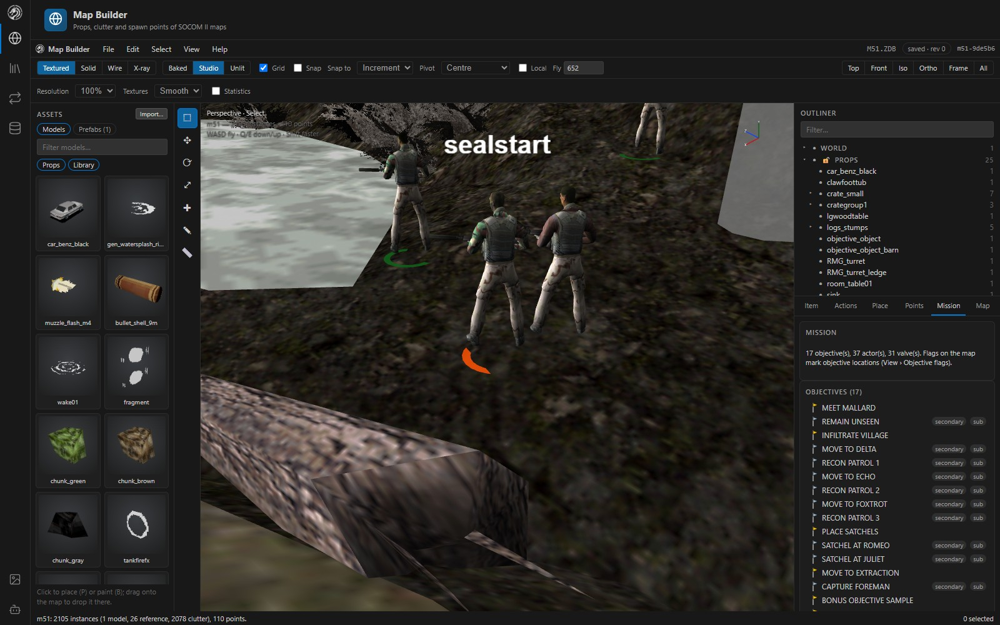

**Placement, clutter and prefabs.** Pick a model from the textured Assets panel and place it as clutter or as a GEO prop, with a live preview, random yaw and scale, and surface alignment. The clutter brush scatters trees and grass by radius, spacing, density and slope, and erases with Ctrl. Save any selection as a prefab and place it again in any map that has its models.

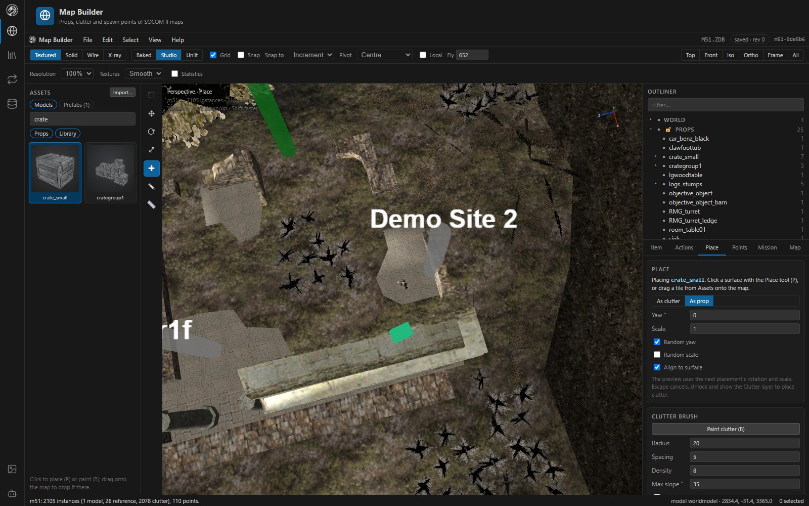

**Map actions and mission tables.** Props with actions show an icon in 3D. The Actions tab explains each action in plain words and edits what the player does, the prompt, and what happens, with fields checked as you type. The Mission tab edits objectives and their map flags, actor AI, mission settings and the weapons available.

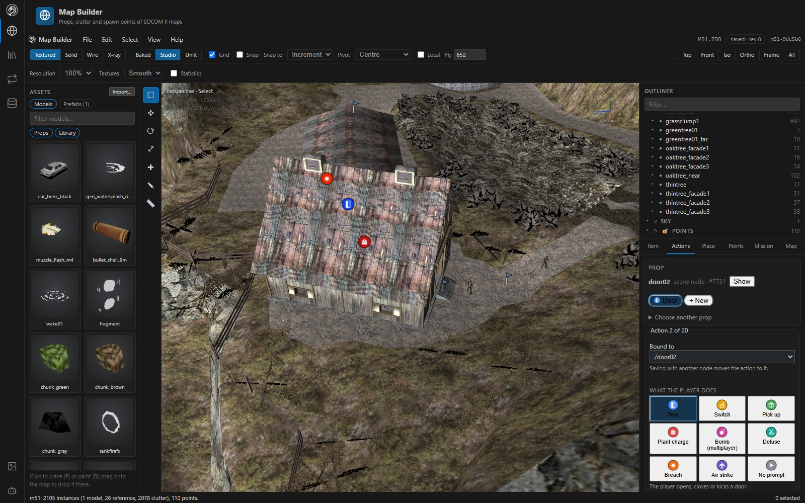

Also in the Map Builder: SOCOM II's own HUD minimap over the map's tactical map, walk mode at eye height, measuring, camera bookmarks, a map check for floating, stacked and overdrawn items, full undo history, and command search.

**[Map Builder guide →](docs/map-builder.md)**

### Model Editor

Edit props, vehicles, weapons and skinned characters from whole objects down to single faces. Extrude and inset faces, edit UVs, paint baked vertex colours or bake ambient occlusion, paint textures directly, and retexture with new textures and palettes made from images.

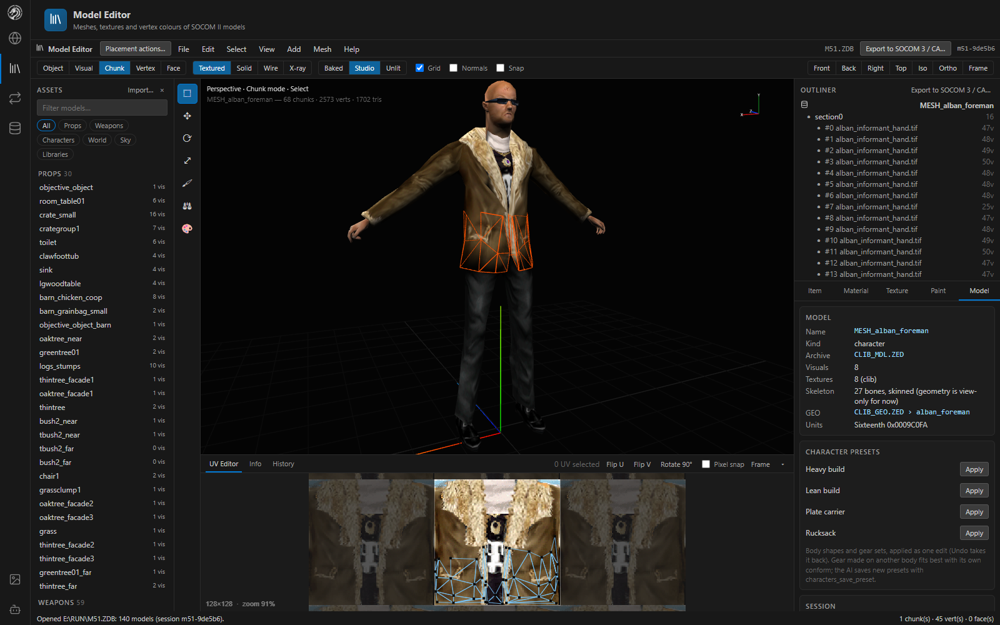

**Characters.** The skin weight view colours the body by how much a bone moves each vertex, and the weight brush repaints it. Pose the character with any clip while you paint, adjust body proportions, and apply presets such as Heavy build or Plate carrier as one edit.

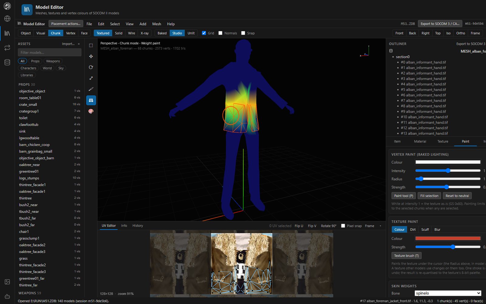

**Weapons, textures and conversion.** Import models and textures from other packages, export OBJ (optionally subdivided and rounded), and convert between SOCOM II, SOCOM 3 / Combined Assault and GTA: San Andreas.

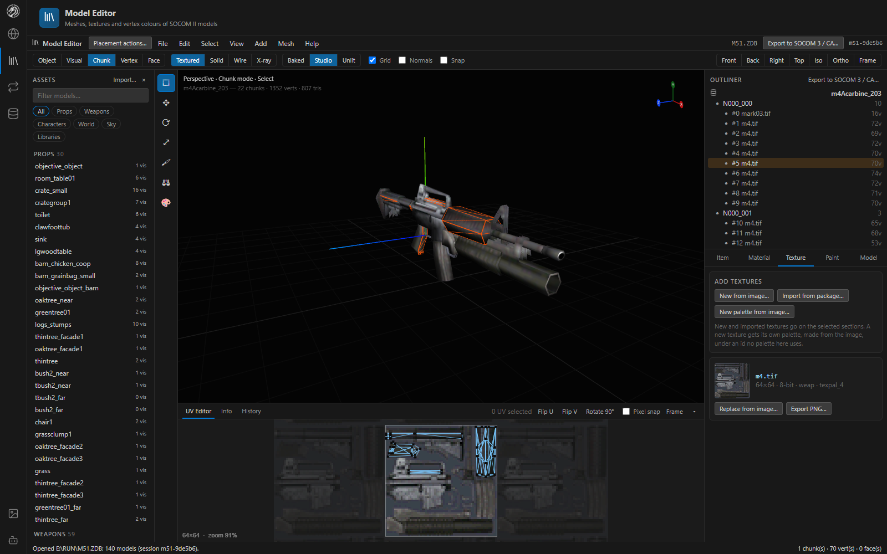

**[Model Editor guide →](docs/model-editor.md)**

### Animation Editor

Preview character clips on skinned models, create, retime and key package clips, and mount a weapon on the clip. With the game's `RUN` folder available, **Fire** plays the weapon's muzzle flash, shell eject and other ZANIM effects as the game does.

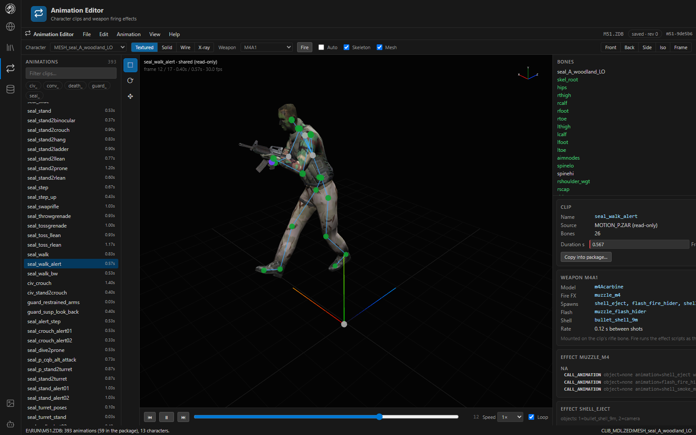

**[Animation Editor guide →](docs/animation-editor.md)**

### Asset Viewer

Browse a whole disc, or any folder, down into packages, archives and records. Every retail file type previews: models, maps, clips, textures, memory-card icons in 3D, sounds, loading screens, RDR tables, AI maps, programs and movies. Send anything to the editor that works on it, export it, or edit it in place with undo.

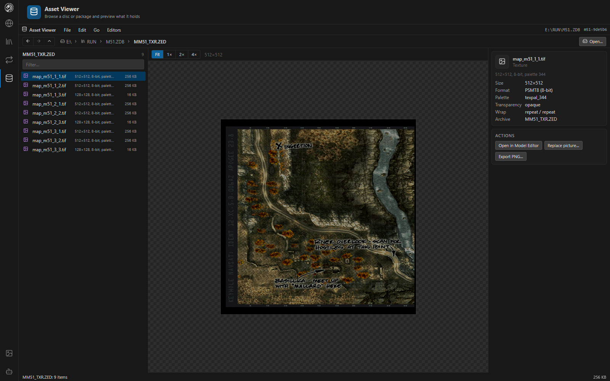

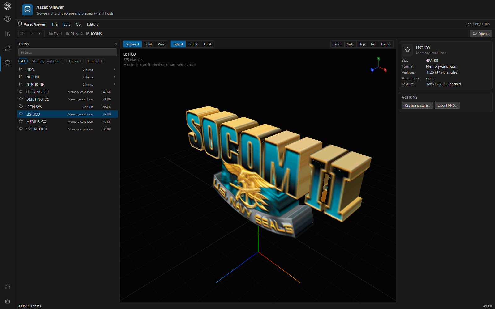

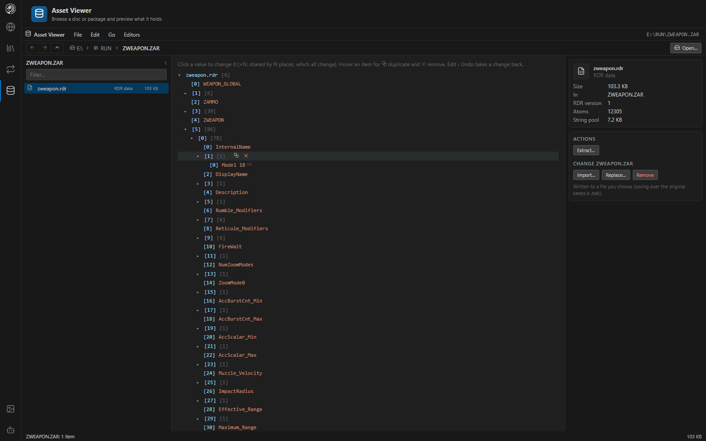

**[Asset Viewer guide →](docs/asset-viewer.md)**

### AI-assisted editing with MCP

The server is also a [Model Context Protocol](https://modelcontextprotocol.io) server at `http://127.0.0.1:8770/mcp`. An assistant works on the same sessions you do: it can read maps, models and mission tables, make undoable edits (with dry runs), validate a map, build weapons and characters, take screenshots, and move the camera. The **AI activity** panel lists every call with the reason the assistant gave, and **Follow AI** brings each edit into view.

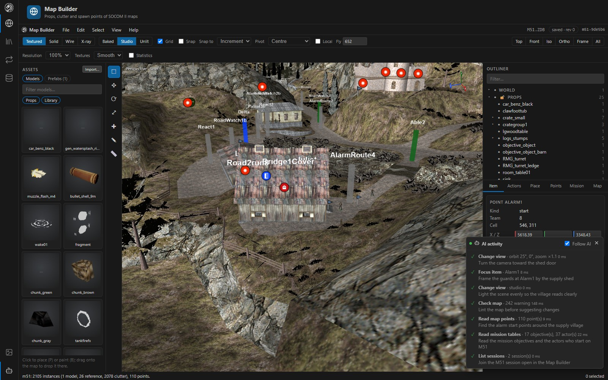

```bash
claude mcp add --transport http mapbuilder http://127.0.0.1:8770/mcp
```

**[MCP server guide →](docs/mcp-server.md)**

## In game

Assets in game:

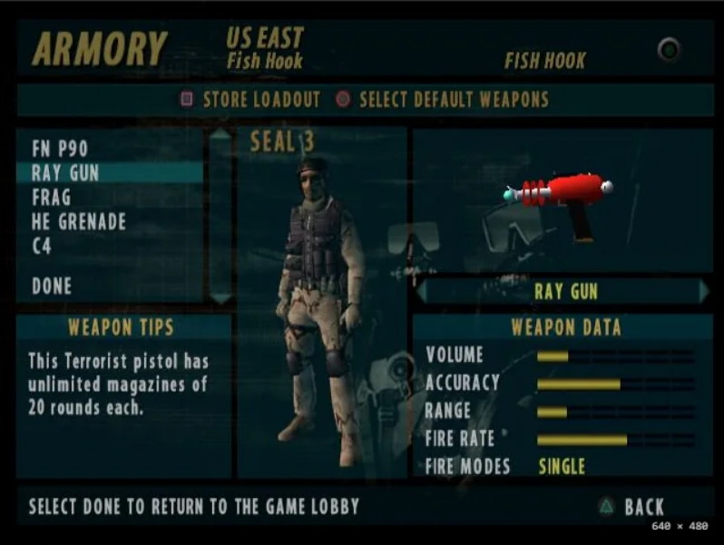

*A custom weapon asset in the armory.*

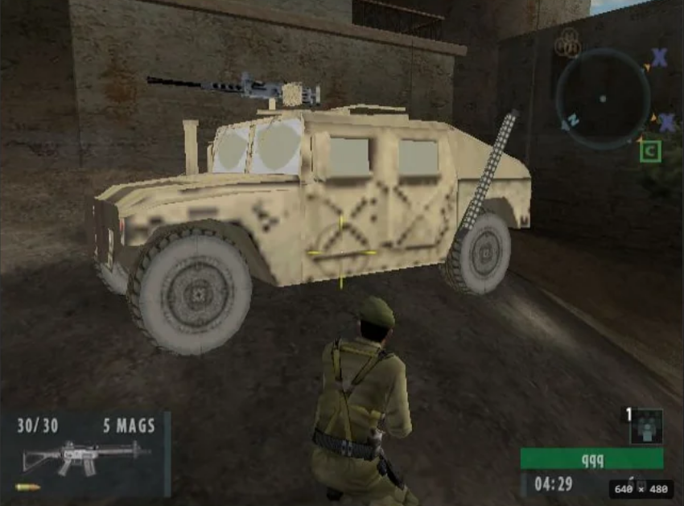

*A vehicle model in game.*

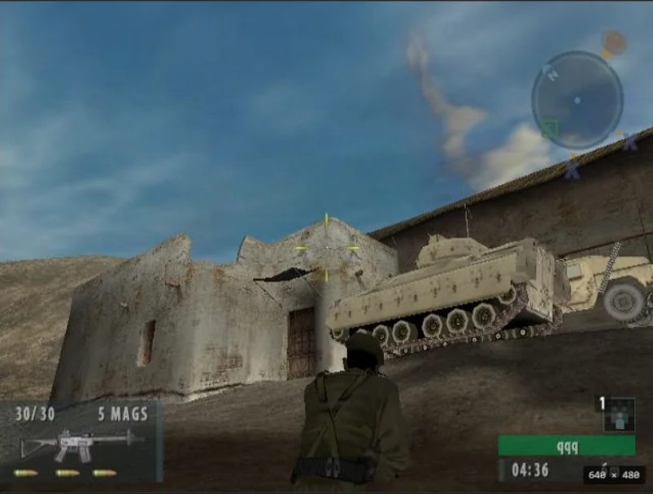

*A tank model in game.*

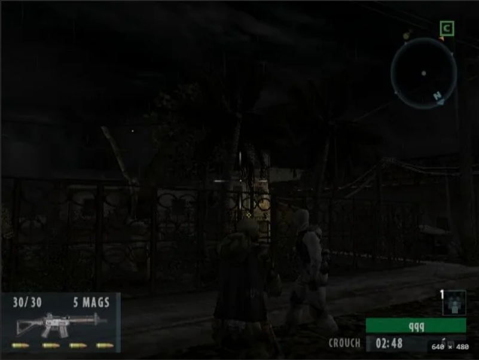

*A character asset from Combined Assault.*

More, including GTA: San Andreas models, in [Game support](docs/game-support.md).

## Getting started

**Requirements:** [.NET 8 SDK](https://dotnet.microsoft.com/download/dotnet/8.0), [Node.js](https://nodejs.org/) 20 or later, and your own SOCOM II game files (this repository ships none).

```bash
cd web
npm ci
npm run build
```

```bash
cd server
dotnet run
```

Open [http://127.0.0.1:8770](http://127.0.0.1:8770), choose **File › Open package…** (`Ctrl+O`) and open a map package such as `RUN\M51.ZDB`.

On Windows you can also run Map Builder as a desktop app (`desktop/MapBuilder.Desktop.csproj`, WebView2). The full guide covers the desktop app, network security and settings: **[Getting started →](docs/getting-started.md)**

> **Keep your originals safe.** Edits stay in the session until you save or export, and saves write a copy by default. Work on copies and test modified packages in game. See [Working with packages](docs/working-with-packages.md).

## Documentation

Start at the **[documentation index](docs/README.md)**. Good first reads:

- [Getting started](docs/getting-started.md) and [Controls](docs/controls.md)
- [Map Builder](docs/map-builder.md), [Model Editor](docs/model-editor.md), [Animation Editor](docs/animation-editor.md) and [Asset Viewer](docs/asset-viewer.md)
- [AI assistants (MCP)](docs/mcp-server.md)
- [File formats](docs/formats/README.md): how every SOCOM II asset type is decoded and written
- [Development](docs/development.md) and the [Roadmap](docs/ROADMAP.md)

## Status and limits

Map Builder is actively developed, and support differs by game and asset type.

- **SOCOM II is the primary tested target.** Not every editing workflow has been verified in game.
- Map, model and animation edits round-trip through save and reopen. Imported models, imported textures and textures made from images render in the editors, but not every combination has been tested in game.
- **Runtime VRAM is limited.** Large textures or many new textures may exceed what a map can use in game.
- An imported character can appear correctly in the editors, but spawning it in a mission also needs the relevant character records.
- SOCOM 3 and Combined Assault workflows vary by format and feature. GTA: San Andreas model export is partial, and Fireteam Bravo has not been tested.
- This repository does not include game assets, or the CodeDesigner runtime source used to inject map items and launch new maps.

## Related projects

| Project | What |
|---|---|
| [CodeDesigner PS2](https://github.com/FatalityDevelopment/CodeDesignerPS2) | The PlayStation 2 reverse-engineering and modding workbench whose research and file-format code Map Builder builds on |

## License

Map Builder is released under the [GNU General Public License v3.0](LICENSE.txt).

*SOCOM U.S. Navy SEALs is a trademark of Sony Interactive Entertainment. This project is not affiliated with or endorsed by Sony and ships no game files.*
