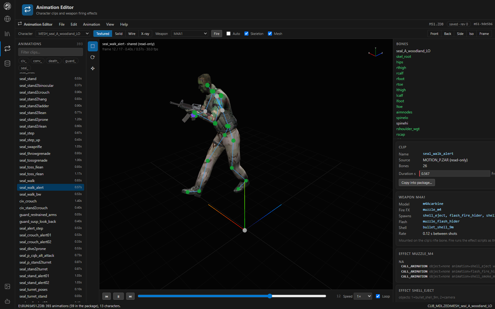

# Animation Editor

The Animation Editor plays SOCOM II character clips on skinned models, edits the clips a package owns, and fires weapons mounted on the clip so you can see their muzzle effects. Characters wear their gear from the game's tables, clips play their timed game events (the smoking guard's cigarette appears in his hand), and you can attach any model to a bone for a clip.

*`seal_walk_alert` playing on a SEAL with the M4A1 mounted. The right panel lists the bones, the clip and the weapon's firing effects.*

## Layout

| Area | What it holds |
|---|---|
| **Header** | The character, shading, the mounted weapon with **Show**, **Fire** and **Auto** (fire continuously), and the Gear, Skeleton and Mesh toggles |
| **Animations** (left) | Every clip, filtered by name or by prefix chips (`civ_`, `conv_`, `death_`, `guard_`, `seal_` …). Package clips come first. |
| **Toolbar** | Select bone (Q), Rotate bone (R), Move bone (G); both transform tools set keys |
| **Viewport** | The character playing the clip, with its skeleton |
| **Timeline** | Previous / next frame (`,` / `.`), play / pause (Space), the scrubber, speed (0.1× to 2×) and loop |
| **Right panel** | Bones, the clip (name, source, bone count, duration), its game events, gear and attachments, and the weapon (model, fire effect, spawned effects, flash, shell, rate) with its ZANIM effect scripts decoded and editable |

## Clips

- Package-local clips in `MOTION_S.ZAR` are editable; the shared `MOTION_P.ZAR` is read-only. **Copy into package…** makes an editable copy of a shared clip.
- Create, duplicate, rename, delete and retime clips.
- Key bones with the gizmo or with exact values in the fields.
- All edits are undoable and are saved with the rest of the package.

## Weapons

The weapon table (`RUN\ZWEAPON.ZAR`) is found beside the package or one folder up, else on the SOCOM II disc: a mounted disc's `RUN` folder, or a SOCOM II `.ISO` in a drive's root, one folder below a root, or your Desktop, Downloads or Documents. Set `MAPBUILDER_SOCOM2_DISC` to the `.ISO` (or its folder) to name it. Files read from an image are copied once to `%LOCALAPPDATA%\MapBuilder\socom2-run`.

The chosen weapon mounts on the clip's `rifle` track under the right hand. **Fire** plays what the game plays when that weapon fires (muzzle flash, shell eject and the rest of its `ZANIM` effects); **Auto** keeps firing at the weapon's rate.

### Editing the fire effects

The effect cards list each script's instructions. Numbers, vectors and on/off values edit in place: a `WAIT`'s seconds, a `LIGHT`'s colour, range and time, a rotation's angles, a loop's count. Each change is an undoable edit to the package's `CZANIM.ZAR` (`setEffectField`), saved with the package, and the weapon fires again to show it. Object and name references, flags, and an `IF`'s terms (which shape the script) stay as they are.

## Gear

A character wears its type's `default_gear` from `RUN\READERC.ZAR › character.rdr`, found the same way as the weapon table. Each item (hat, goggles, holster, vest kit, pouches, satchel) is a model in `FLIB_MDL.ZED`, placed on its bone at the offset the gear table gives. **Type** (in the Gear and attachments card) picks among the character types drawn with the model (a SEAL model is `jungle_A51` and others); **Gear** in the header turns it off, and **Show** beside the weapon hides the weapon. Eyeball gear is left off, and gear named after a weapon (the satchel) starts unticked unless the type carries that weapon (see [Characters](formats/characters.md)). Gear offsets can be adjusted to try a placement, but they are not saved: the table lives on the disc, not in the package.

## Game events

`RUN\READERC.ZAR › motion.rdr` says how the game plays each clip: flags (`NoFire`, `NoTurn`, `DropWeapon` …), values (`looped`, `playback`, `BlendTime`) and **callbacks**, ZANIM effects run at a time into the clip. The **Game events** card lists them; orange markers on the timeline jump to them.

A callback that turns objects on or off shows or hides the matching gear. In `guard_light_cigarette`, `show_cigarette` at 0.05 s turns on `cig` and `cigarette`, so the cigarette (worn on `lhand`, hidden until then) appears in the hand; `guard_toss_cigarette` hides it again. Gear left shown or hidden by one clip stays that way into the next, as in game.

## Attachments

**Attach** puts a model on a bone for the current clip: a gear-table item (on its own bone and offset) or any prop, weapon, gear or effect model in the package (on the bone you pick). Select an attachment to change its bone, position and rotation; **×** removes it. Attachments are kept per clip in this viewer's browser storage. In game, a model follows a clip through the character's gear and the clip's callbacks, which are on the disc.

The same mount is used for the characters the [Map Builder](map-builder.md#characters-at-their-start-points) draws at their start points.

## Related

- [Animations format](formats/animations.md): motion clips and ZANIM effect scripts
- [Characters format](formats/characters.md)
