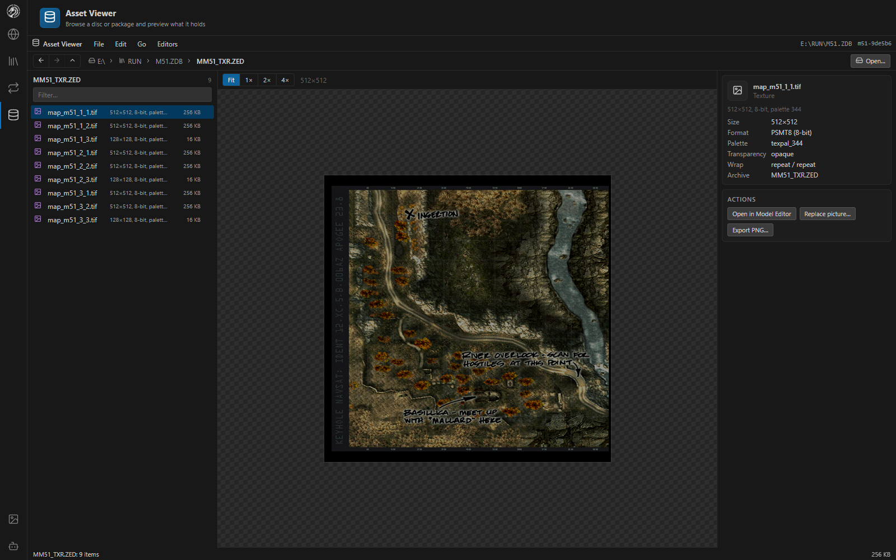
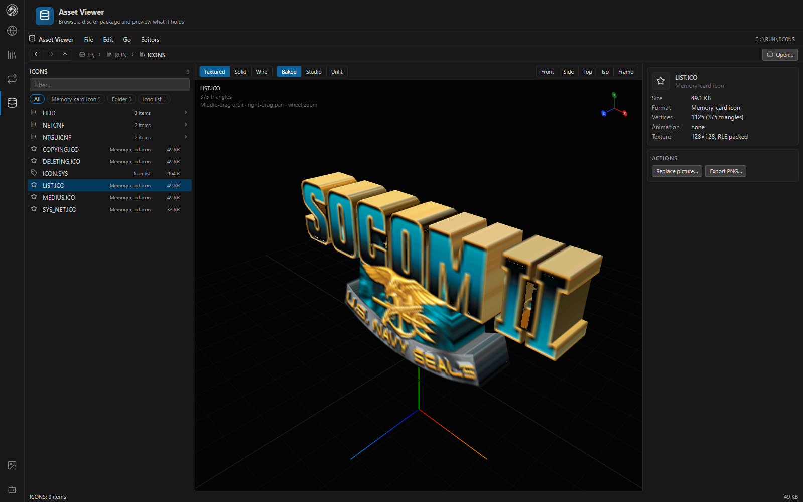
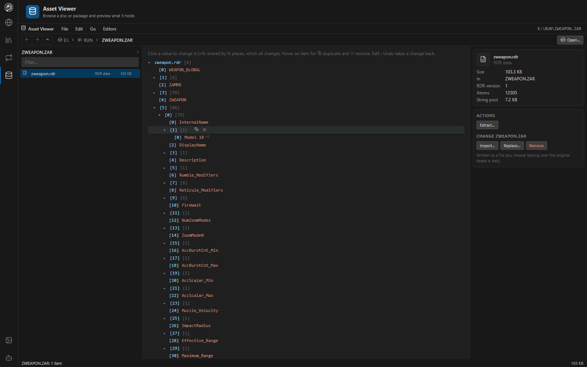

# Asset Viewer

The Asset Viewer browses a whole disc (or any folder) down into packages and archives, previews every file type on the retail disc, edits records in place, and sends what you select to the editor that works on it.

*A page of M51's tactical map (`MM51_TXR.ZED`) with its size, format and palette, and actions to open, replace or export it.*

## Layout

The page uses the editors' layout: the browser on the left, the preview in the middle, and on the right what the selection is and what can be done with it.

- **Open a folder** with **File › Open folder…** (`Ctrl+O`): the SOCOM II disc's drive, its `RUN` folder, or a folder of packages.
- Browse folders, `.ZDB` / `.CDB` packages and the `.ZAR` / `.ZED` archives inside them, with breadcrumbs, Back / Forward / Up, a filter and kind chips.
- Lists of thousands of records scroll without slowing down (`RUN/SOUNDS/VAGSTORE.ZAR` holds 10,942).
- Double-click or Enter opens an item; Backspace goes up.

## Previews

Previews use the editors' own code: models in the Model Editor's viewport, a package's composed map in the Map Builder's (**Show map**), clips playing on a character in the Animation Editor's, and textures through the same decoder.

Every file type on the retail disc previews:

| Kind | Preview |
|---|---|
| Package archives | Models, textures, palettes, GEO definitions and animation clips, from the same asset session the editors use. A loose `RUN/MOTION_P.ZAR` borrows a session from a package beside it. |
| Memory-card icons (`.ICO`) and icon lists | In 3D with their texture |
| Sounds | `.VAG`, the `VAGSTORE` / `BNKSTORE` stores, and `.BNK` / `.BD` banks sample by sample, played in the page |
| Screens | The `RAW` / `RGB` loading screens |
| Tables | RDR trees and AI maps |
| Text | `.CNF` and other text files |
| Programs | `.ELF` and `.IRX`: sections and the IOP module name |
| Movies (`.PSS`) | Picture size, frame rate and length. **Convert for preview** extracts the PS2 "SShd" PCM sound track (which ffmpeg cannot read) and has ffmpeg join it to the picture as an H.264 / AAC MP4, kept in `%LOCALAPPDATA%\MapBuilder\movies`. Needs ffmpeg on the server. |
| Anything else | A hex dump with strings |

## Actions

- **Open in** the Map Builder, Model Editor or Animation Editor.
- **Export** a texture, screen or icon texture as PNG, or a sound as WAV.
- **Extract** any record as stored.
- **Import… / Replace… / Remove** change a package's files or an archive's records. The result is written to a file you choose; saving over the open file keeps a `<name>.bak` the first time.

## Edit in place

Many records can be edited directly, with **Edit › Undo** (Ctrl+Z), **Redo** (Ctrl+Y) and **Save changes…** (Ctrl+S):

- RDR values, strings and list items (duplicate and remove)
- AI map headers and points
- Text files and `icon.sys` titles
- A byte patcher for any record
- Pictures (textures, `RAW` / `RGB` screens, icon textures) replaced from an image
- GEO scene nodes (`nparams`, model references) and ZANIM effect script fields

Edits go through the package's asset session (a `.ZDB`'s, or a loose file's folder's) and are spliced into their archives in place, so every other byte stays as it was. SOCOM 3 / Combined Assault archives and GTA: San Andreas (`.ISO` or `.IMG`) open read-only.

## Related

- [Disc survey](formats/disc-survey.md): every map file on the disc and what each holds
- [RDR tables](formats/rdr.md), [ZED / ZAR containers](formats/zed-zar.md), [Packages](formats/packages.md)
