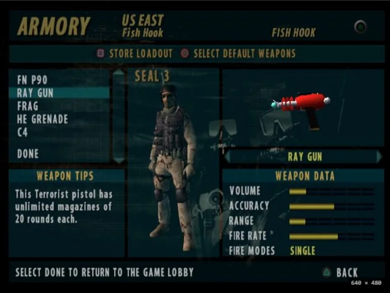
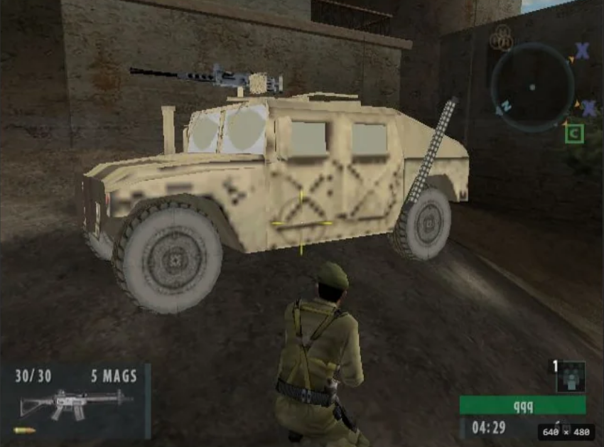
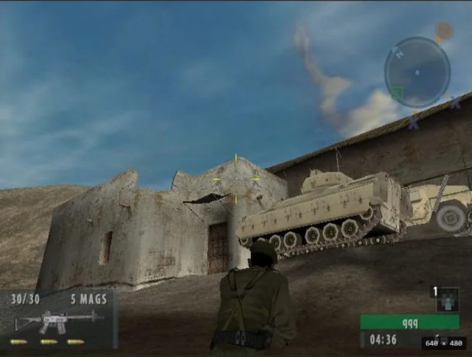
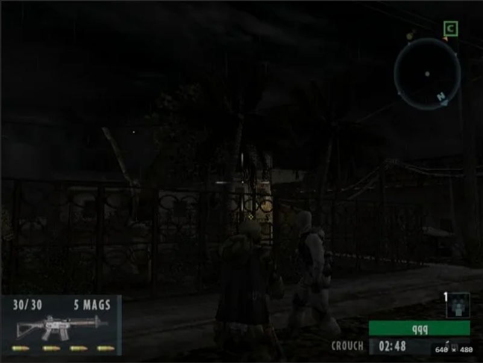
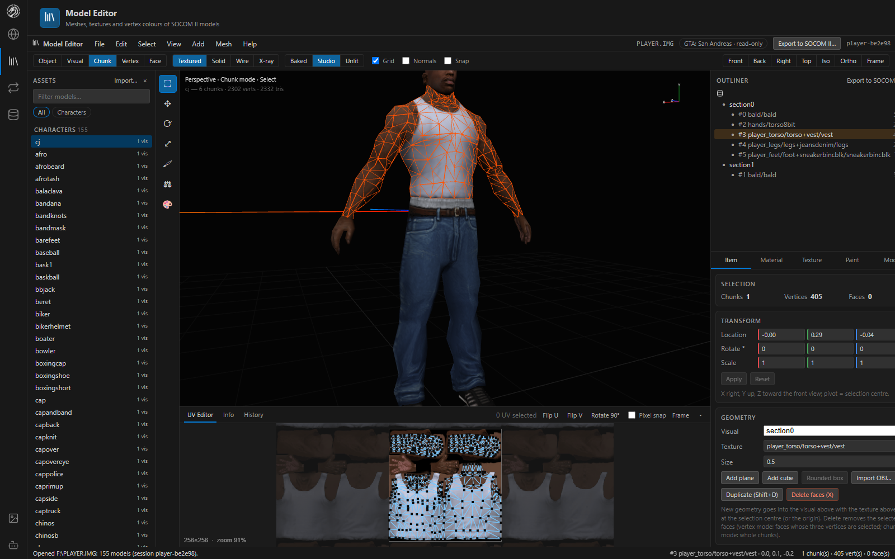
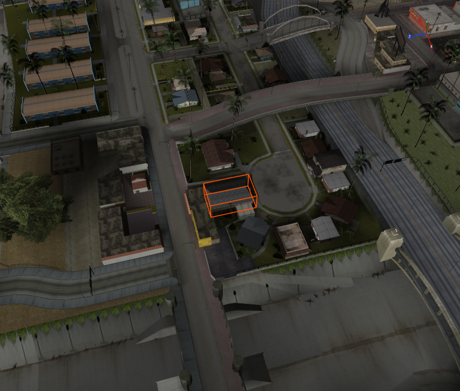
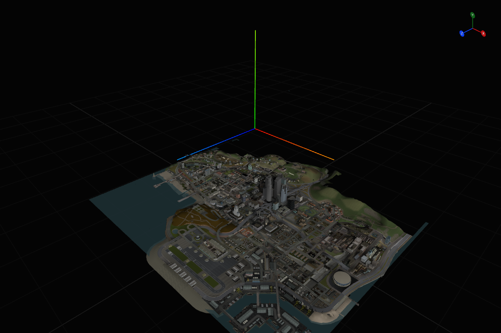

# Game support

SOCOM U.S. Navy SEALs II is the primary target. Combined Assault also supports selected map edits. Other PlayStation 2 titles that share its engine or formats open for reading and model conversion.

| Game | Open | Edit | Convert |
|---|---|---|---|
| **SOCOM U.S. Navy SEALs II** | Packages (`.ZDB`, `.CDB`), loose `.ZED` / `.ZAR`, unpacked folders, the disc | Maps, models, textures, palettes, animations, mission tables and disc records | To SOCOM 3 / Combined Assault |
| **SOCOM: Combined Assault** | Location archives by name, missions, world, actors, loadouts and named objective areas | Points, actor starts and headings, valve start values, allowed weapon slots and world placements. Save to a copy. | Models to SOCOM II |
| **SOCOM 3** | Compatible asset archives | Map edits verified on the Combined Assault disc only | Compatible models to SOCOM II |
| **Grand Theft Auto: San Andreas (PS2)** | Mounted disc, ISO, IMG or DFF; the map by area | Frame positions, geometry transforms and material properties; move and turn map placements. Save DFF, IMG or IPL copies, or a patched `.ISO`. | Models and selected character clips to SOCOM II |
| **Star Wars: Battlefront** | `.ISO` or a `.LVL`: models, textures and maps | Move and turn props, command posts and vehicle spawns. Save `.LVL` copies or a patched `.ISO`. | Soldiers, weapons, vehicles and props to SOCOM II |
| **SOCOM: Fireteam Bravo 2 (PSP)** | A map folder or any ZDB in it: the world, props, characters (bind pose), weapons, textures, missions and points | Move placed props, vehicles and trees; move and rename points; actor starts. Save ZDB copies or a patched disc image | — |
| **SOCOM: Fireteam Bravo / Fireteam Bravo 3** | Not tested | — | — |

## SOCOM II

Map, model and animation edits round-trip through save and reopen. Imported models, imported textures and textures made from images render in the editors, but not every combination has been tested in game, so test on copies. See [Working with packages](working-with-packages.md) for the limits that apply in game (VRAM, character records, AIMAPS points).

### In game

*A custom weapon asset in the armory.*

*A vehicle model in game.*

*A tank model in game.*

*A character asset from Combined Assault.*

## SOCOM: Combined Assault

Each location is a `RUN\<hash>.ZAR` archive. Open a location or mission by name, such as `G:\RUN\COMPOUND\SP432.ZDB`, then use **Mission** in the toolbar to switch missions. The map shows named points, squad starts and flags at named objective regions. Verified demolition layouts also show SEAL and Terrorist team starts. The **Mission** tab lists actors, their equipment and starts, allowed weapons and valves.

Move a point within its current AI zone or rename it. The editor updates actor starts that use the old name. Check compiled actions and scripts in game after a rename. In the Mission tab, edit an existing actor start and heading, valve value or allowed weapon slot. Move a world object to reposition its node, attached meshes and children. The original AI navigation and baked visibility still apply.

Undo and redo work across missions in the same archive. **Save copy** writes the complete archive into the selected folder. To see shared weapon models and labels when reopening, place the copy beside the game's `GLOBAL.ZDB`. In-game verification is pending. [File layouts and in-game check](formats/ca-missions.md#editing-and-saving)

The world includes each island's scatter props (rocks, trees, crates), and water and terrain blend layers draw translucent as the game's GS state sets them ([Combined Assault worlds](formats/ca-worlds.md)). Scatter props cannot be moved yet.

## Grand Theft Auto: San Andreas (PS2)

In the **Model Editor**, choose **File → Open package**, select the mounted GTA disc and click **Open folder**. You can also open its ISO, a single IMG archive or a loose DFF. Opening the disc gives the editor access to the game's model definitions, texture dictionaries, vehicle paint schemes, clothing and animation banks. Filter the model list by name or kind. The archive label distinguishes models with the same name, such as the Coach bus and CJ's coach jacket.

In the **Item** tab, select a frame to change its position relative to its parent, or select a geometry to scale and offset its vertices. The fields use GTA coordinates, with Z up. For a missing texture, use **Missing textures** to select its material. Pick an image from **Available textures** to preview it, or enter a native texture name of up to 31 printable ASCII characters. **Apply material** writes that name and the RGBA channels. Choose an individual clothing model to edit CJ's outfit pieces. The **UV Editor** can move, flip, rotate and snap primary UV coordinates on sections with stored UVs. Each edit supports undo and redo. For clothing files containing multiple body-shape clumps, the editor displays and edits the first clump.

**File → Save model as DFF** writes the selected model. **File → Save edited IMG archive** writes a full copy of the selected model's archive with all its edited entries. Fixed-size edits use the existing IMG entry when it has its own sector range. A longer texture name can grow a DFF. If its entry outgrows its slot or shares sectors with another entry, the writer appends the edited DFF and updates its directory record in the copy. A DFF stores references to textures. Keep the relevant TXDs alongside a loose model, or reopen the IMG in a copy of the original disc layout for its full dependency set.

**Export to SOCOM II** builds a memory-card pack from the current model including its session edits. Choose **File → Export with options** to include animation clips for a character. Automatic pack names include the source archive and model, so the Coach bus and the coach jacket export separately. If an automatic output name is occupied, the exporter selects another one. The resulting pack can be reopened in the editor. In-game verification of the new native edits and conversion changes is pending.

On the US PS2 disc (SLUS-20946), the editor produces geometry for all 15,208 source DFFs and the assembled CJ preview. All 32,555 texture records decode. The loader uses declared texture dictionaries, their parents, placement links to higher-detail models, and exact raster names. When it searches across archives it requires all candidates to agree on the pixels and keeps the player clothing separate. Of the original 219 unresolved material references, 47 now resolve. The remaining 172 appear in the editor for manual repair.

### The map (view only)

Open the San Andreas disc image or mounted disc in **Map Builder**. On the US PS2 disc the editor resolves all 48,584 IPL placements. It opens on Grove Street (LAE2). Use **Area** to switch zones, enter interiors, or view a city's low-detail overview. **Time** selects the hour used to show timed objects, including night-lit windows. Water uses the disc's texture and per-vertex flow and wave values for animated ripples.

Pick a building or prop in **Assets** and click a surface to place it, or drag the model onto the map. Use **Duplicate** or **Delete** on selected placements. A new placement uses the nearest placement's IPL and interior within the selected area. Use the gizmo or position and yaw fields to move or turn placements. A building's dedicated distant model follows its transform. When several buildings share one distant model, the editor keeps it in place and reports why.

Undo and redo apply to the whole edit, including a batch. **Save copy** writes edited IPLs under their disc paths and writes both copies of the IMG for edited stream IPLs. **Save to disc image** writes a patched ISO. See [the continuation notes](gta-map-continuation.md) for verification details.

## Star Wars: Battlefront

Open the disc image (`Star Wars - Battlefront (USA).iso`) or a loose `.LVL` in the Model Editor or Asset Viewer. Every level under `DATA/_LVL_PS2` except the streamed sound and movie stores is indexed when the disc opens, which takes a few seconds. Models are named by their level, such as `SIDE/IMP.LVL` for `imp_inf_stormtrooper`.

- **Model Editor:** characters, vehicles, weapons, first-person models, props and sky domes, textured. Characters show in their bind pose; animations are not read yet.
- **Asset Viewer:** a `.ISO` lists its files by disc path, and a `.LVL` lists its models and textures for preview.
- **Map Builder:** pick one of the disc's 22 maps from the **Map** list. It draws the terrain (heights, the base texture layer and the baked lighting, with the cut patches of caves and hangars), the placed objects and the sky dome (turn on the Sky layer). The game draws its sky in a small dome that follows the camera; here it is scaled to enclose the map. Sound emitters and particle effects are not drawn.
- **Command posts, paths and regions:** command posts (with their starting team) and vehicle spawns are map points. The **Paths** layer draws spawn paths (green), AI paths (blue) and the map's boundary (red); the **Regions** layer draws each command post's capture (yellow) and control (orange) regions and the map's other regions. Click a name in the outliner to frame it. Ambient sound regions are left out. Cylinder regions are drawn with the first and third sizes as radii, which is not confirmed.
- **Conversion to SOCOM II:** **Export to SOCOM II** in the Model Editor turns a soldier (retargeted onto SOCOM II's character through its bone_* skeleton, scaled head to toe), a weapon (barrel along SOCOM II's +X, the muzzle from its hp_fire hardpoint), a vehicle (as a static prop) or any prop into a memory-card pack. SOCOM II's templates come from its RUN folder or its disc image. Battlefront animations are not converted yet.
- **Editing:** move and turn props with the gizmo or the Item fields, and drag command posts and vehicle spawns. Placements cannot be scaled, and props cannot be added or deleted yet. A command post's regions and spawn path stay where they are when it moves. **File › Save copy** writes the edited levels into a folder at their disc paths (`TAT/TAT2.LVL`); saving to a path ending `.ISO` (for example through the assistant's `assets_save`) writes a copy of the whole disc with the edited levels in place, which needs the disc's size free. Edits keep every file's size, so the copy is otherwise byte for byte the original. Not yet tested in game.

The terrain's blended texture layers, map edits that change sizes (adding or deleting props, editing paths and regions) and animations are planned. The PS2 position quantisation, bone-space vertices and the terrain and world layouts follow research by the [openbf](https://github.com/sprucey149/openbf) project (MIT).

## SOCOM: Fireteam Bravo 2 (PSP)

Open a map folder from the UMD, such as `K:\PSP_GAME\USRDIR\RUN\FORT_MP`, or any `.ZDB` in it. The Map Builder draws the island's terrain, buildings and placed props, textured, with the sky in the **Sky** layer. Pick a game mode or campaign mission from **Mission** to show its named points (starts, bomb and sabotage places, doors, extraction) and, in the Mission tab, its actors with their character model, loadout and starts; actors stand at their starts holding their first gun when its model is known. The Model Editor lists the island's props, the characters in their bind pose and the weapons from `RUN\GLOBAL.ZDB`. Move placed props, vehicles and trees with the gizmo or the Item fields, and move or rename points; **File › Save copy** writes the edited ZDBs into a folder at their places under `RUN` (`FORT_MP\ISLAND_F.ZDB`). The terrain and buildings are not movable. Mission text, objectives, animations and conversion are not done yet, and nothing edited has been tried in game. [File layouts](formats/psp.md)

## Saving to a disc image

Every editor has **Save to disc image…** (the Asset Viewer: **Save changes to disc image…**). It runs the game's usual save, then writes a copy of the game's disc image with the saved files put in place: SOCOM II and SOCOM 1 packages, Combined Assault archives, GTA: San Andreas IMG archives (a model edit saves its whole IMG) and Battlefront levels. Pick the `.ISO` the package came from when it was opened from a drive or a folder; a session opened from an `.ISO` uses that image.

A file that still fits its sectors is written in place. A file that grew moves to the end of the image and the disc's directory points to it, so the copy can be larger than the original; past 4.7 GB it no longer fits a single-layer DVD but still runs in an emulator. The copy needs the image's size free on the target drive. Games that look files up by name (through the ISO 9660 directory) find the moved file; a game that reads fixed sector numbers from its own table would not, and none of the supported games is known to.

## Not included

This repository does not include game assets, or the CodeDesigner runtime source used to inject map items and launch new maps.
