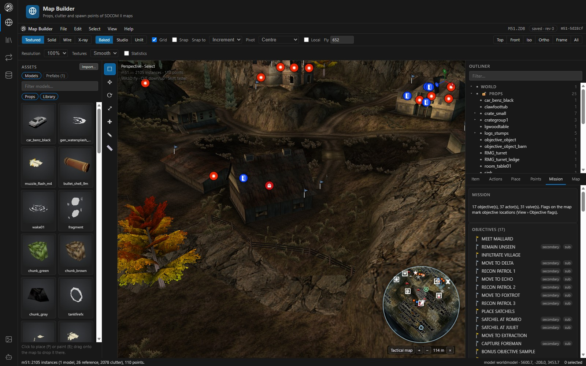
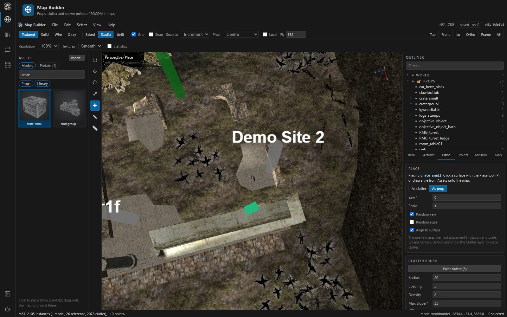
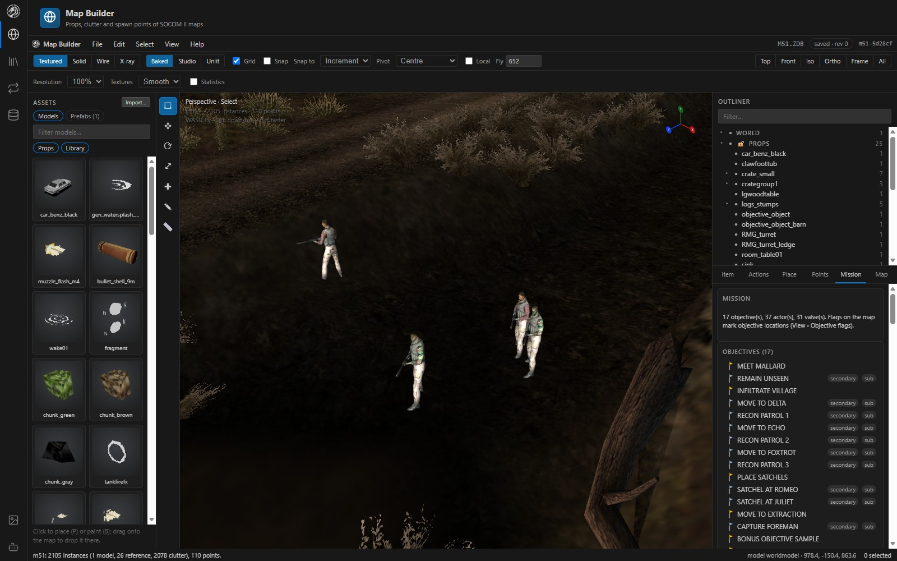
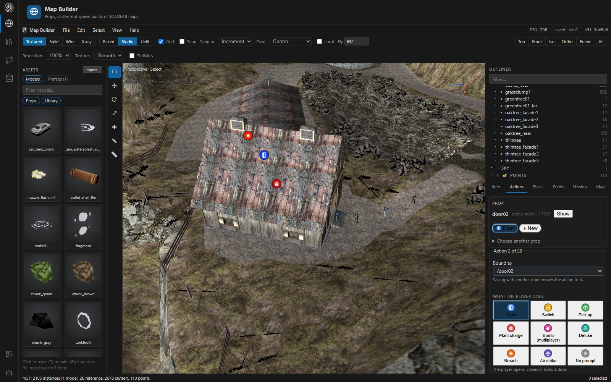
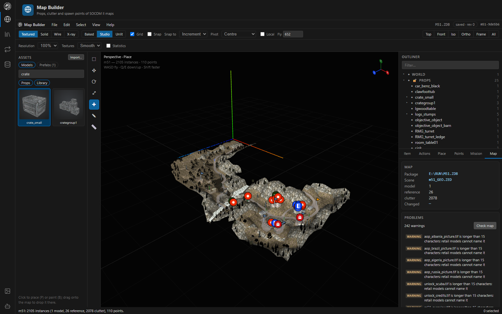
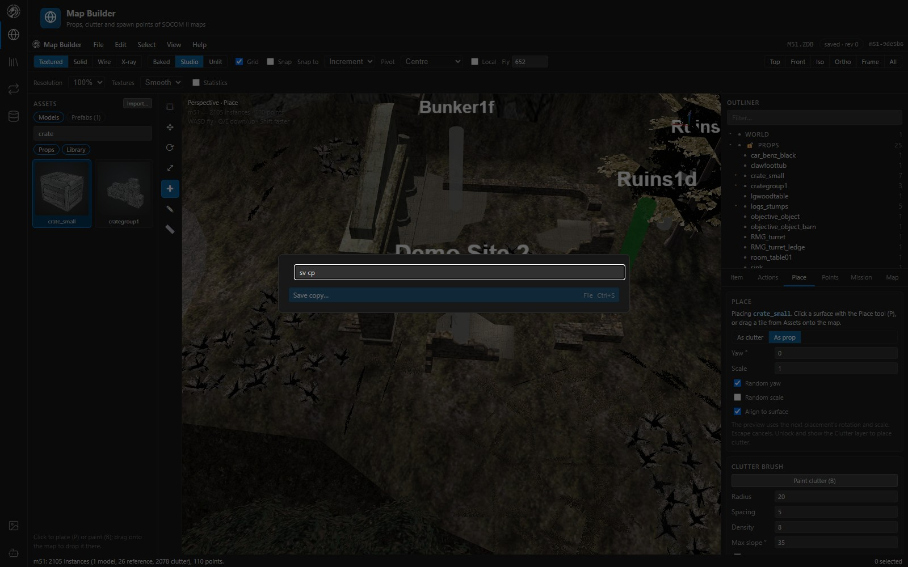
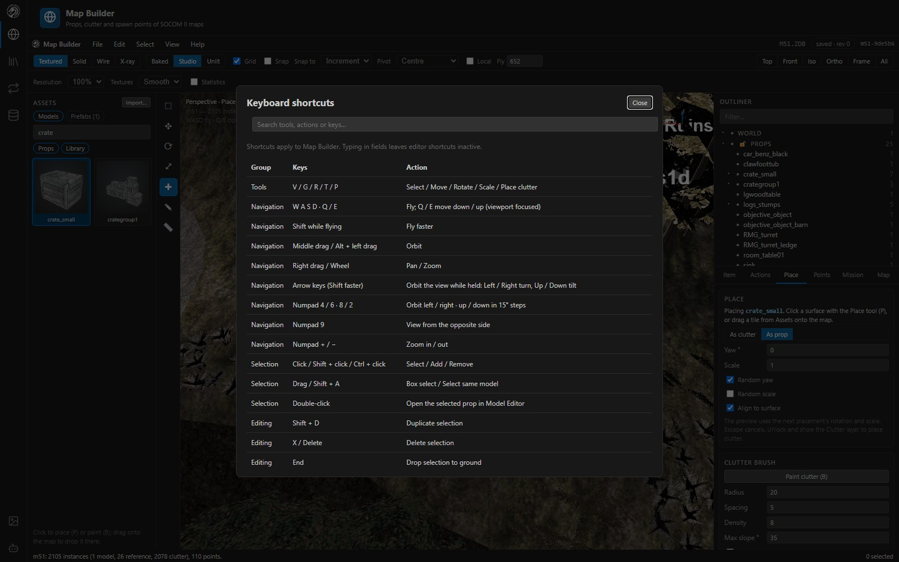

# Map Builder

The Map Builder composes a SOCOM II map the way the game draws it (the world model, placed props, clutter, sky, textures and baked lighting) and lets you edit what is placed in it: props, clutter, spawn and waypoint points, object actions and mission tables.

*M51 in Studio lighting, with action icons over the props, objective flags, the HUD minimap (N) and the Mission tab.*

## Layout

| Area | What it holds |
|---|---|
| **Header** | Shading (Textured, Solid, Wire, X-ray), lighting (Baked, Studio, Unlit), grid, snapping, pivot, local axes, fly speed and camera presets. A second row sets render resolution, texture filtering and statistics. |
| **Assets panel** (left) | The package's props and library models, and your saved prefabs, as textured thumbnail tiles |
| **Toolbar** | Select (V), Move (G), Rotate (R), Scale (T), Place (P), Paint clutter (B), Measure (M) |
| **Viewport** | The composed map. Double-click a prop to open it in the Model Editor. |
| **Outliner** (right) | Layers (World, Props, Clutter, Sky, Points) with their models; each layer can be hidden or locked |
| **Side tabs** | Item, Actions, Place, Points, Mission, Map |
| **Status bar** | What the last action did, the cursor's world position and the selection count |

## Select and transform

- Click a prop, clutter item or point to select it; Shift adds, drag draws a box. Locked layers are skipped by clicks and box drags.
- Move, rotate, scale, duplicate (Shift+D) and delete (X or Delete) props and clutter; End drops the selection to the ground.
- **Rotate** turns about any axis, not only yaw. **Scale** stretches GEO props along one axis; clutter keeps a single scale, which is all its format holds.
- **Pivot**: the selection's centre, each item's own origin, or the first selected item. **Local** moves a single prop along its own axes.
- **Snap to**: the increment (grid), the **surface** under each item (it slides over the ground and stays on it), or the nearest **vertex** under the cursor.
- **Align and distribute** a multi-selection on X, Y or Z from the Item tab: line up minimums, centres or maximums, or spread centres evenly.
- Edit a multi-selection at once (move by, turn by, set scale).
- The status bar shows the move, turn or scale while you drag.

## Place props and clutter

1. Pick a model or prefab in the **Assets panel** (filter by name; chips switch between Props and Library models, or Prefabs).
2. Click the tile to arm the **Place** tool (P), or drag it onto the map to drop it where it lands.
3. In the **Place** tab choose **As clutter** or **As prop** (a GEO reference), the yaw and scale (or random yaw and a random scale range), and whether to **align to the surface**.
4. A preview follows the cursor; click a surface to place. Escape cancels.

Clutter placement needs the Clutter layer visible and unlocked.

**Clutter brush** (B): drag over the ground to scatter the picked model. Settings are radius, spacing (kept between placements and from that model's existing clutter), density and the steepest slope it paints on. Random yaw and scale make it look natural. Hold Ctrl, or tick **Erase**, to remove that model's clutter instead. One stroke is one undo step.

**Import from package…** (File menu or the Place tab) brings a prop, vehicle, weapon or character from another package into this one, ready to place.

### Prefabs

Select props and clutter, then choose **Assets › Prefabs › Save selection as prefab…**. A prefab places again, in this map or any other map that has its models, as a single edit (one undo step). Prefabs are stored in `%LOCALAPPDATA%\MapBuilder\prefabs` (or `MAPBUILDER_PREFABS`).

## Characters at their start points

Actors are drawn as their characters at their AIMAPS start points (View › **Characters at start points**): textured, turned to their start's heading and posed in their animation set's Stand clip. Each figure holds **its own weapon** and wears **its own gear** (View › **Character weapons** and **Character gear** turn them off) (hats, goggles, holster, vest kit, pouches, satchel), read from the game's chartype table (`RUN\READERC.ZAR › character.rdr`, found beside the package, on a mounted disc or in a SOCOM II `.ISO`; see [Animation Editor](animation-editor.md#weapons)) and `zweapon.rdr`. On M51, for example, the SEALs hold the M4A1 SD, smugglers the 9mm Sub, the foreman the 870 and snipers the M82A1A.

- The SEAL team stands together at the player's start; on multiplayer maps the `player` template is not drawn.
- Each figure has a ring on the ground in its point's colour; click it to select the point.
- Figures stay when the Points layer is hidden (only the pillars, labels and rings go).
- **Mission › Actors** shows each actor's weapons. *Holds in 3D* picks another weapon for a character type; this is a view-only choice remembered in your browser, because the chartype table is shared by every map.
- Without a chartype table the figures fall back to stand-ins.

How headings, stances and loadouts are read is documented in [Map mission tables](formats/map-tables.md).

## Map actions

Props with actions show an icon above them in the 3D view, one per kind: door, switch, pick up, plant charge, bomb, defuse and breach. This includes doors and breach points whose geometry is part of the world model.

Click an icon, or select a prop, and the **Actions** tab opens on it. The tab explains what an action is, shows the prop's actions as chips, and edits one in groups:

| Group | Fields |
|---|---|
| *What the player does* | The action kind, picked by its icon |
| *Prompt* | The prompt icon (with a preview) and reach distance |
| *What happens* | The mission valve, map animations and whether it works only once |
| *Advanced* | The less common fields |

A new action starts from what the map's other actions of that kind use. Fields are checked as you type (whole numbers, a valve or animation the map lacks, a name several placements share). All of the map's actions are listed by kind below. View › **Action icons** turns the icons off. In the Model Editor, **Placement actions…** opens the same inspector filtered by model.

The file layout and the disc inventory are in [Map interactions](map-interactions.md).

## Mission tables

The **Mission** tab reads the map's `READERM.ZAR` tables ([format](formats/map-tables.md)):

- **Objectives**: HUD objectives with their in-game text (titles and briefing lines are editable), their map location (editable, and drawn as flags in 3D with View › **Objective flags**), valves and nav points.
- **Actors**: who starts on the map (display name, character, start points, teams) with their AI accuracy, courage and surrender.
- **Mission settings**: AI respawn and recycle values, the satchel timer, and the **weapons available** in the mission (its `Enable_*` valves) as checkboxes.
- **World settings** (read-only): lighting, fog, draw distance and the map extents.

Every change is one undo step. The same tab offers experimental climb and ladder surfaces; see [Map interactions](map-interactions.md) for their limits.

## Spawn and waypoint points

The **Points** tab and the Points layer show the map's AIMAPS points: start points in green, waypoints in blue and others in grey. Select one in the outliner or the viewport and move it, or type its X / Z. Points can be renamed and retyped, but not added or removed yet (their table sits between structures that are not fully decoded). See [AI maps and points](formats/aimaps.md).

## Map check

The **Map** tab summarises the package and lists problems. **Check map** adds checks that need the drawn scene: clutter and props floating above the surface under them, a second copy stacked on the first, and areas that draw far more triangles than the rest of the map. Click a problem to select what it is about. The same lint is available to AI assistants as `assets_validate`.

## Navigation and view tools

| Tool | How |
|---|---|
| **Minimap** | N, or View menu. SOCOM II's own HUD radar, drawn with the game's art (`RUN\COMMON\HUD2_TXR.ZED`) over the map's tactical map (`RUN\UI\MM<nn>_TXR.ZED`) or a top-down render. It turns with the view, shows actors, spare start points, nav points, objectives and action props; the wheel zooms and a click moves the view. Tactical maps are placed in the world by hand in `server/data/tacmaps.json` (M51 so far). [Format notes](formats/hud.md). |
| **Walk mode** | Shift+F, or View menu. Walk at eye height (16 units above the ground) with W A S D; Shift runs, Escape stops. |
| **Measure** | M. Click two points to see the distance in units and metres (about 10.5 units to a metre). |
| **Hide / isolate / show all** | H, Shift+H, Alt+H. View-only: hidden props and clutter are not drawn and cannot be picked. A status-bar badge counts them; click it to show them again. |
| **Camera bookmarks** | View › Bookmark this view…, kept per package in your browser |
| **Facade trees** | Face the camera, as they do in game |
| **Render settings** | Resolution 100%, 75% or 50%, smooth or pixel texture filtering, and FPS / draw-call / triangle / resource statistics. Pixel density is capped at 2×. |

## Command search and history

**Command search** (F3 or Ctrl+Shift+P): type a few letters of any menu command ("sv cp" finds *Save copy…*) and press Enter to run it. The Model Editor has it too.

**History** (Map tab) lists every undo and redo step in order. Click a step to go back to before it, or forward to it.

**Help › Keyboard shortcuts…** (or `?`) opens a searchable list of every control.

## Recovery

- **Autosave**: every 3 minutes, a recovery copy of each session with unsaved edits is written to `%LOCALAPPDATA%\MapBuilder\autosave\<package>.autosave.ZDB` (see [Settings](getting-started.md#settings)). The session itself stays unsaved.
- Loading warnings stay visible with a **Retry map loading** action. A failed package switch clears the old map, and scene-loading failures block editing until a reload succeeds.

## Related

- [Controls](controls.md)
- [Working with packages](working-with-packages.md)
- Formats: [GEO scenes](formats/geo.md), [Clutter](formats/clutter.md), [AI maps and points](formats/aimaps.md), [Map mission tables](formats/map-tables.md), [HUD radar](formats/hud.md)
