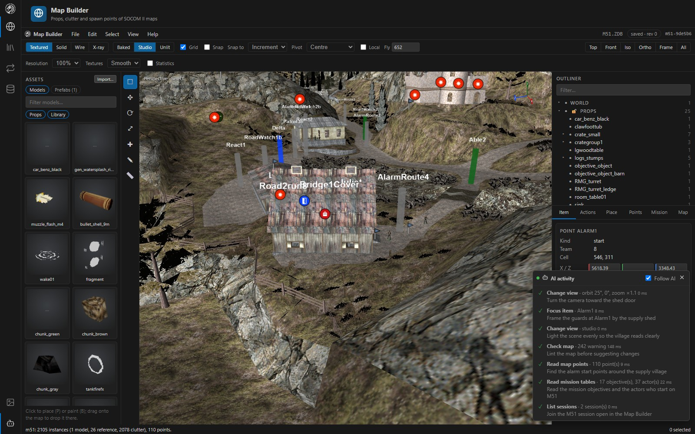

# AI assistants (MCP server)

Map Builder's server is also a [Model Context Protocol](https://modelcontextprotocol.io) server, so an AI assistant can open packages, read maps and models, make undoable edits and drive the app while you watch.



*The AI activity panel lists every call with the reason the assistant gave; with Follow AI on, the Map Builder frames what the assistant asked to see.*

## Connect

The endpoint is `http://127.0.0.1:8770/mcp` (Streamable HTTP). The repository's `.mcp.json` registers it for Claude Code; for another project or client:

```bash
claude mcp add --transport http mapbuilder http://127.0.0.1:8770/mcp
```

Claude Code discovers tools when a session starts, so start Map Builder (`dotnet run`) before opening the Claude session; a session started without it sees no `mapbuilder` tools until it is restarted. Claude Code also asks once to approve the project's `.mcp.json` server.

## Watching the assistant work

The assistant works on the same asset sessions as the pages:

- The **AI activity** panel (activity bar, robot icon) lists every call with its reason, duration and result.
- With **Follow AI** on, edits bring their page forward: the Map Builder reloads and frames the moved prop or point, the Model Editor opens the edited model, and the Asset Viewer opens the edited record (an RDR value, a GEO node, a ZANIM instruction, a palette) and marks it. While the Map Builder shows a package, an edit to one of its models (a prop built for the map) reloads the map instead of switching to the Model Editor; `ui_show page=models` still goes there.
- When the Map Builder's session is closed (`assets_close`, or another page closed it), the page opens the package again rather than retrying a session that is gone. `assets_open` on the path it shows switches it to the new session.
- Browsing with `viewer_list` / `viewer_preview` moves the Asset Viewer along, and any edit to the package it shows reloads it.
- Edits stay undoable (`Ctrl+Z` undoes the assistant's too) and nothing is written until a save.

## Tools

| Tools | Purpose |
|---|---|
| `assets_open`, `assets_sessions`, `assets_status` | Open or join a package session |
| `assets_list_models`, `assets_describe_model`, `assets_model_mesh`, `assets_list_textures`, `assets_list_palettes`, `assets_texture` (as an image), `assets_map_scene`, `assets_map_points`, `assets_map_collision`, `assets_map_tables`, `assets_list_animations`, `assets_animation`, `assets_weapons`, `assets_uv_layout` | Read |
| `assets_effects`, `assets_weapon_fx` | Read ZANIM effects and what firing a weapon plays |
| `viewer_list`, `viewer_preview`, `viewer_edit`, `viewer_extract` | Browse any folder, file or archive record as the Asset Viewer does, read its typed preview (RDR subtrees, AI maps, GEO scene nodes, clutter pages, decoded ZANIM effects, palettes), change it in place, and copy a record out. Edits are undone and saved with `assets_undo` / `assets_save` on the session `viewer_edit` returns. |
| `assets_edit` (every `ASSET_EDIT` op; `dryRun: true` previews one without changing anything), `assets_undo`, `assets_redo`, `assets_save`, `assets_close` | Change, save and close |
| `assets_save_prefab`, `assets_list_prefabs`, `assets_delete_prefab` | Save placed props and clutter as a reusable group; `assets_edit {op: placePrefab}` places one in any map as one undo step |
| `assets_validate`, `assets_history` | Lint a map (missing models, broken transforms, duplicate points, long texture names, VRAM budget); list the undo / redo steps |
| `assets_export`, `assets_entry` | Export a model to SOCOM 3 / CA; read or write one of the package's files (with unsaved edits) |
| `characters_check`, `characters_pack`, `characters_presets`, `characters_save_preset`, `characters_delete_preset` | Check a reshaped character for seams, folds and floating gear; ship a character as a memory-card pack under a donor name; manage character presets |
| `weapons_list`, `weapons_template`, `weapons_texture`, `weapons_create`, `weapons_definition`, `weapons_pack` | Build a new weapon from a template in a weapon archive |
| `mesh_refine_obj` | Subdivide and round an OBJ file |
| `fs_places`, `fs_list` | Find packages on disk |
| `package_inspect`, `package_edit` | List and change the files of a package or archive on disk (no session) |
| `ui_screenshot`, `ui_state`, `ui_show`, `ui_focus`, `ui_view` | See and drive the app: a screenshot of the 3D view, page and selection state, open a page or model, frame an item, and set shading, lighting, backdrop, camera preset, orbit and zoom |
| `mapbuilder_command` | Any backend command from the [command reference](command-reference.md) |

Tool arguments are checked against each tool's schema before it runs: unknown names, wrong types, values outside an `enum` or range, and a missing `reason` are errors. `assets_map_scene` pages with `offset` / `nextOffset`, and a reply too long for the model's context comes back as valid JSON with `truncated: true`.

## Notable edit operations

`assets_edit` accepts every `ASSET_EDIT` op (see the [command reference](command-reference.md#edit-operations)). Ops built mainly for assistants include:

- `newProp` copies a map prop to reshape it (`addTexture` materials, `addMesh` shapes, `hideVisual`); `fitBounds` refits it and `placeInstance` puts it in the map.
- `addCharacterMesh` puts gear on a character, rigid on one bone or bending with the body; `removeCharacterSection` takes it off.
- `scaleBones` reshapes body parts (thicker, longer, bigger, blending across joints); `transformCharacter` moves whole sections.
- `paintTexture` colours a skin by body part, guided by `assets_uv_layout`.
- `mapTable` / `mapText` change the mission tables read by `assets_map_tables`.
- `setPoint` renames or retypes spawn points.

## Security

The pages listen on `GET /api/events` (Server-Sent Events) and answer screenshot and state requests on `POST /api/ui/reply`. `/mcp` refuses requests from other sites' pages (a foreign `Origin` or a non-JSON body), and the whole server only answers requests addressed to `localhost` (see [Getting started](getting-started.md#network-and-security)).
