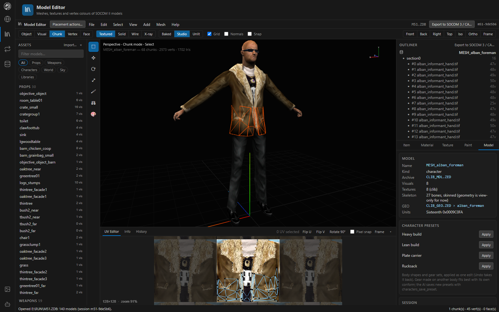
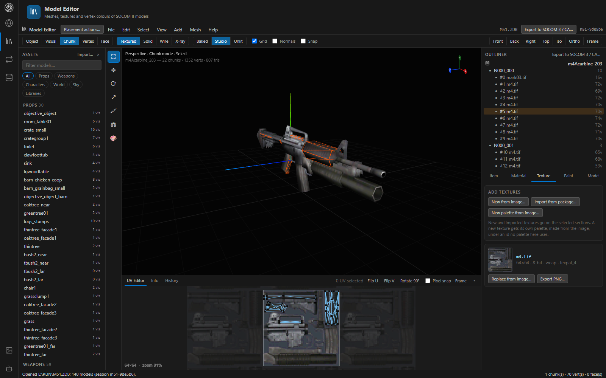
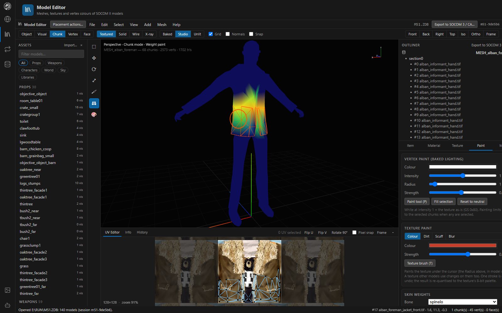

# Model Editor

The Model Editor edits the models in a package (props, vehicles, weapons and skinned characters) at the object level and down to single vertices, along with their textures, palettes and baked vertex colours.

*A skinned character with one chunk selected: its UVs show in the UV Editor below, and the Model tab lists its skeleton and the character presets.*

## Layout

| Area | What it holds |
|---|---|
| **Header** | Selection mode (Object 1, Visual 2, Chunk 3, Vertex 4, Face 5), shading, lighting, grid, normals, snap and camera presets |
| **Assets panel** (left) | Every model in the package, filtered by kind (Props, Weapons, Characters, World, Sky, Libraries) |
| **Toolbar** | Select (Q), Move (G), Rotate (R), Scale (S), Vertex paint (P), Weight paint (B), Texture paint (T) |
| **Viewport** | The model, with the selection outlined |
| **Bottom panel** | UV Editor, Info and History |
| **Outliner** (right) | The model's visuals and chunks with their textures; each can be hidden |
| **Side tabs** | Item, Material, Texture, Paint, Model |

Open a model by clicking it in the Assets panel, by double-clicking a prop in the Map Builder, or by double-clicking a model in the Asset Viewer.

## Geometry

- Select by object, visual, chunk, vertex or face; move, rotate and scale; mirror, flip normals and snap to grid.
- **Add** planes, cubes, rounded boxes or an OBJ; duplicate and delete faces.
- **Extrude** the selected faces along their normal with walls around them, or **Inset** them (I) into a smaller copy with a ring of faces (Item tab, for props, weapons and vehicles).
- **Soft radius** makes nearby vertices follow a move, fading out with distance. **Mirror X** moves the selection's mirror image across X = 0 with it.
- Edit UVs in the **UV Editor**: flip, rotate 90°, pixel snap and frame.

## Textures and palettes

The **Texture** tab lists the textures the model uses, with their size, depth and palette.

- **Retexture** sections, or **replace** a texture from any image (PNG, JPG, BMP or WebP).
- **New from image…** creates a texture with its own palette (or reusing one); **New palette from image…** makes a palette.
- **Import from package…** copies a texture from another package.
- **Export PNG** saves any texture.

New textures are 8-bit indexed, a power of two on each side (8–512; by default the image's size rounded, at most 256), with a 256-colour palette made from the image: 32-bit when the image has soft alpha, otherwise 16-bit like most retail palettes. Retail models name textures in 16-byte fields, so a texture applied to them needs a name of at most 15 characters. Details are in [Textures and palettes](formats/textures.md).

## Painting

- **Vertex paint** (P, Paint tab): paint baked vertex colours with a colour, intensity, radius and strength, fill a selection or reset to neutral.
- **Bake ambient occlusion** into the vertex colours: creases, undersides and insides darken so a prop looks seated in the world.
- **Texture paint** (T): paint the texture under the cursor in Colour (keeps the texture's shading), Dirt, Scuff or Blur. One stroke is one undo step.

## Characters

- **Skin weight view** (Paint tab): pick a bone and the body is coloured by how much that bone moves each vertex, from blue (none) to red (fully).
- **Weight brush** (B): add, subtract or set the chosen bone's weight. One stroke is one undo step.
- **Pose** the character with any clip and scrub its time to see gear and joints bend while you paint. Move, rotate and scale wait for the bind pose.
- **Character presets** (Model tab): apply a body shape (Heavy build, Lean build) or a gear set (Plate carrier, Rucksack) to any skinned character as one edit. AI assistants can save new presets with `characters_save_preset`.
- **Body proportions** (Item tab): adjust a bone's thickness and length in the package.
- **Add › Rounded box** places geometry at the selection centre using the target texture.

These edits are all undoable. Their MCP equivalents are `assets_edit` with `scaleBones`, `addCharacterMesh` (a `box` shape with a positive `radius`), `setSkinWeights` and `applyCharacterPreset`. Mesh layout is documented in [Characters](formats/characters.md).

## Import, export and conversion

- **Import from package…** (Assets panel or File menu) copies a model from another package: its MDL record, its GEO definition (a character's skeleton), every texture its sections name with their mip levels, their palettes, and any models its definition is built from. Undo removes the whole import.
- **Export OBJ** writes the model with its MTL and images.
- **Export to SOCOM 3 / CA** converts a SOCOM II model; Combined Assault and GTA: San Andreas models convert to SOCOM II. See [Game support](game-support.md).

### Rounded OBJ export

For a softer silhouette, choose **File › Export rounded model as OBJ** on an open model, or **File › Round an OBJ file** for an existing export.

- One subdivision level multiplies the triangle count by four.
- **Strength** controls how far the surface moves; the **crease angle** controls which edges stay sharp.
- The optional XYZ centre, radius and scale shape a local region.
- The OBJ keeps its material references and needs its MTL and images alongside it.

The MCP tool `mesh_refine_obj` takes `inputPath`, a new `outputPath`, and the same `levels`, `strength` and `crease` controls. Its optional `brushes` array applies local shaping in order; for example `{"center":[0,15,0],"radius":[5,3,4],"scale":[1.2,1,1.1]}` broadens a chest centred at that position in OBJ coordinates.

## Command search and history

**Command search** (F3 or Ctrl+Shift+P) and the **History** tab in the bottom panel work as in the [Map Builder](map-builder.md#command-search-and-history).

## Related

- [Controls](controls.md)
- Formats: [Models](formats/models.md), [Characters](formats/characters.md), [Textures and palettes](formats/textures.md), [GEO scenes](formats/geo.md)
